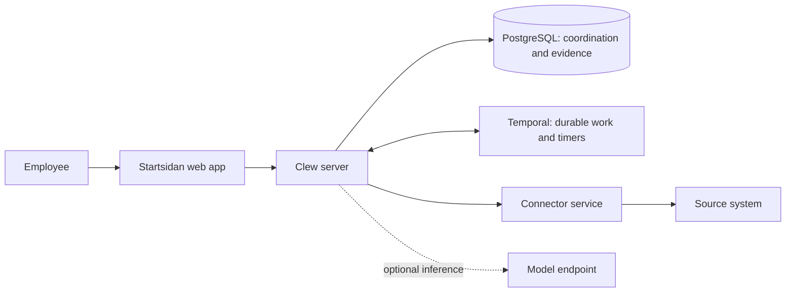

# Clew

Clew is an open-source workspace for an employee's work across systems. It brings together what needs attention, the information needed to decide, and actions with receipts from the source. It is built for the public sector; its Swedish employee interface is called **Startsidan**.

An employee can find a colleague, check their calendar, review an invoice or follow up a task without first choosing which system to open. Source systems keep their business records. Clew owns the coordination: who may see the work, what the person approved, what happened afterwards and when to bring it back. This includes tasks that need changes in several systems, assembled into one proposal with one approval and a separate outcome for each system.

## How it fits together

Clew has a web application, a modular backend and independently deployed connectors. A **connector** translates a source system into named operations and data that Clew understands. Its manifest describes those operations and how read results can be displayed. Clew supplies the interface and checks access on every invocation.



A connector can be written in any language. An administrator registers its URL, transport secret and audience without rebuilding Clew. The browser calls Clew; the connector calls the source. The optional assistant uses the person's allowed reads and proposals; source writes pass through a separate human approval flow.

PostgreSQL records approved intent before dispatch. Temporal runs the durable work and waits. The connector reports what the source actually did; an uncertain outcome remains visible until it can be resolved.

[Work across connectors](docs/architecture/working-across-connectors.md) explains how connectors declare facts and follow-up steps, how Clew assembles a job for one approval, and how dependent work is planned to become a later proposal. The job API and execution/watch machinery exist; the complete employee and administrator interfaces and receipt-driven continuation are still planned.

## Understand the platform

1. [What Clew is](docs/overview.md): the employee experience, ownership and key concepts.
2. [How Clew works](docs/architecture/overview.md): components, data, reads, decisions and follow-up.
3. [What is implemented](docs/reference/status.md): working paths, fixture evidence and remaining limits.

The [documentation home](docs/README.md) is the full reading map. [Vision](docs/vision.md) describes product direction; [decisions](docs/decisions/README.md) and [reviews](docs/reviews/README.md) preserve the reasoning.

## Build a custom connector

Start with one useful read, then add only the features the integration needs.

1. [Create a connector](docs/guides/creating-a-connector.md): run an example, define a manifest and implement the request boundary.
2. [Adapt the directory example](docs/guides/example-custom-directory.md): connect a real API, add search and declare views.
3. [Authorize requests](docs/guides/authorization.md): verify Clew's actor and enforce source access.
4. [Add actions and receipts](docs/guides/actions-and-receipts.md) when the source supports approved writes.
5. [Test, register and deploy](docs/guides/testing-and-deployment.md).

The [protocol reference](docs/reference/connector-protocol.md), [JSON Schema](docs/protocol/connector-protocol.schema.json) and [complete example manifests](docs/generated/README.md) define the integration contract. A running Clew also serves its own protocol and manifest validator under `/api/protocol`.

## Run and contribute

[Local development](docs/maintainers/local-development.md) starts the application and synthetic source services. [Maintainer documentation](docs/maintainers/README.md) covers tests, operations, branding and documentation upkeep. Application commands run in the devcontainer; for example:

```sh
docker exec -w /workspace clew-app-1 bun run docs:check
```

That check validates generated references and local links, then runs a signed connector exchange without a database, identity provider, model or source system. Coding agents should start with [llms.txt](llms.txt) and the generated [context map](docs/context.json).

Clew is a developing proof of concept. The development connectors use synthetic data, and a passing fixture does not establish readiness for a real-system pilot. The [support matrix](docs/reference/status.md) and [reliability acceptance](docs/reference/reliability-acceptance.md) state the limits.
