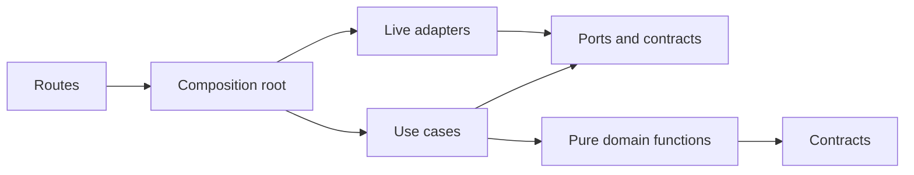

# Backend structure

Clew's server is a modular monolith: one Node application, organised by responsibility, with ports and adapters at the edges. External integrations are independent connector services. Start with the [architecture overview](overview.md) for the running system; this page maps it to code.

A **module** is a bounded responsibility inside the server. A **connector** is an integration contract and deployment unit an operator or source developer meets. A **capability** is an operation exposed through the registry. These are related concepts, not interchangeable names.

## Repository map

```text
apps/
  server/src/       Node/Hono backend with the durable engine (DBOS) in-process
  web/src/          Startsidan React frontend
packages/
  contracts/src/   shared TypeBox schemas and types
  connectors/src/  capability registry, protocol, transport and validation
  db/src/          PostgreSQL schema, migrations and database adapters/helpers
  calendar/src/    calendar domain, provider port, CalDAV and Microsoft 365 adapters
  ui/src/          shared Astryx-based UI, branding and calendar rendering
connectors/
  hello/           small protocol demonstration; in-memory writes
  phonebook/       read/search/view example with fixture and HTTP adapters
  reference/       synthetic durable source for execution recovery
  eneo/            optional delegated document-retrieval connector
  hr/ finance/ incidents/ communication/ timesheet/ payroll/
                   independent synthetic sources in the development stack
tests/             unit, shared store/provider contracts, database and browser suites
scripts/           development, conformance, migration and documentation commands
```

Connectors under `connectors/` import no Clew application or workspace package. Neither `apps/` nor `packages/` imports their runtime implementation; the served protocol's documentation examples are the explicit exception. Tests can run their handlers in-process while still exercising the remote protocol. See [D61](../decisions/D61-fixture-sources-are-independent-connectors.md).

## Server map

| Folder/file | Responsibility |
|---|---|
| [main.ts](../../apps/server/src/main.ts), [startup.ts](../../apps/server/src/startup.ts) | HTTP app, readiness, registration initialization and launching the durable engine. |
| [auth.ts](../../apps/server/src/auth.ts), [system-context.ts](../../apps/server/src/system-context.ts) | Session-backed identity and current-grant identity for background work. |
| [routes/](../../apps/server/src/routes/) | Auth, business API, connector callbacks/public keys, administration and served protocol. |
| [composition/](../../apps/server/src/composition/) | Wires ports to live stores, calendar providers, model endpoints, clocks, ids and workflow delivery. |
| [connectors/](../../apps/server/src/connectors/) | Live registry, signed authority, remote registration, reconciliation and administration. |
| [threads/](../../apps/server/src/threads/) | Authorized card/history reads, occurrence refresh, decisions, reminders, timers and attention. |
| [assistant/](../../apps/server/src/assistant/) | Conversation/router, model tools, answer context, provider/model administration and adapters. |
| [modules/calendar/](../../apps/server/src/modules/calendar/) | Calendar capabilities, planning, reads, approval, execution and bounded follow-up. |
| [modules/people/](../../apps/server/src/modules/people/) | Users (D62, D68, D85): the SCIM 2.0 server's use cases, the derivation of a person's grant from memberships and the mapping, the users administration, and the internal `people.*` reads over a `UserReads` port; no managed connector lifecycle. |
| [modules/appearance/](../../apps/server/src/modules/appearance/) | The installation's theme and logo (D98): the public read, the administration's changes behind `admin.appearance` with their audit rows, and what an uploaded logo must be. The theme file's format is in `@clew/contracts`. |
| [modules/competence/](../../apps/server/src/modules/competence/) | Competence (D108), an owned domain: the catalogue of competence types behind `admin.competence`, holdings a manager registers for their reports, the status computed from the dates when read, erasure and export; the copy of what a source answering the holdings profile holds, read through the `HoldingsPort` that composition fills, and the mapping of a source's types to the catalogue (item 9); the bundled `competence` connector with its reads, figure and scan, created disabled for an administrator to switch on. |
| [modules/search/](../../apps/server/src/modules/search/) | Composite search, source budgets, result contracts and answer-card capability. |
| [modules/errands/](../../apps/server/src/modules/errands/) | The combined errand list `clew.errands` over every `<id>.errands` in the person's scope: budgets, the order across systems and the systems that did not answer (D89). The registry joins it into the core connector beside the search. |
| [modules/requests/](../../apps/server/src/modules/requests/) | The combined list `clew.requests` over every `<id>.requests` in the person's scope: what the person ordered or reported in a service desk, with the errand list's budgets, what waits on the person first and the systems that did not answer named (D123). The registry joins it into the core connector beside the errand list. |
| [modules/news/](../../apps/server/src/modules/news/) | The combined news list `clew.news` over every `<id>.news` in the person's scope: budgets, newest first across sources, and a source that fails or answers out of shape left out unnamed (D112, amended 2026-11-11). The registry joins it into the core connector beside the errand list. |
| [modules/talks/](../../apps/server/src/modules/talks/) | The first domain Clew owns ([D96](../decisions/D96-talks-is-the-first-owned-domain-the-round-and-action-points-behind-a-profile.md)): the round of utvecklingssamtal, a talk marked held, and action points (`commitment`) with their owner's card, in its own tables with the text sealed; erasure and export as use cases. Registered as the bundled connector `talks`, which answers the talks profile. Writes are use cases behind `routes/talks.ts`, never capabilities. |
| [modules/talk-seam/](../../apps/server/src/modules/talk-seam/) | The composites `clew.talks` and `clew.commitments` that Clew's pages read: they ask the one system that answers the talks profile for the person (the built-in module, or another system's connector), check the answer against the profile and keep only rows about people the reader may see (D96 items 8 and 9). |
| [modules/entities/](../../apps/server/src/modules/entities/) | A person or a unit and what the sources that declare `about` say of it (D97): who may be asked about, the batch of keys under a budget with nothing stored, the list, rows, opened entity and section behind `routes/entities.ts`, and an action from the entity's menu started as a card. See [Entities](entities.md). |
| [modules/executions/](../../apps/server/src/modules/executions/) | Approval ledger, source progress/reconciliation, compensation, job/watch state; every intent starts its workflow in its own transaction (D86). |
| [modules/jobs/](../../apps/server/src/modules/jobs/) | Fact/follower binding and cross-system proposal assembly. |
| [modules/operations/](../../apps/server/src/modules/operations/) | Reliability diagnostics over ports. |
| [scheduler/](../../apps/server/src/scheduler/) | Scheduled job use cases, queue and durable ownership adapters. |
| [dbos/](../../apps/server/src/dbos/) | Workflow definitions, activity bindings, the engine runtime, heartbeat/takeover and delivery adapters ([D85](../decisions/D85-dbos-transact-replaces-temporal-as-the-durable-engine.md)). |

There is no bundled `packages/connectors/src/mock` implementation or separate `modules/figures` module. Figures come from connectors through the registry. Model providers are administered in the database, not selected by an `adapters/provider.ts` environment adapter.

## Dependency direction



Ports are interfaces describing what a use case needs, such as a store, clock or source operation. An adapter implements a port using PostgreSQL, a network protocol or memory. A test supplies memory adapters to the same use case factory that production uses.

| Kind | Typical location | Rules |
|---|---|---|
| Contracts and ports | `packages/contracts`, module `model.ts`, `ports.ts` or `contracts.ts` | Schemas, types, errors and interfaces. No business I/O. |
| Domain | `domain.ts` or domain helpers | Pure computation. No database, network, clock, runtime framework or Node built-in. |
| Use cases | `usecases.ts` or `usecases/` | User operations receive the actor, not an HTTP request. Own access checks and transactional state/audit through ports. Time and ids are supplied dependencies. |
| Adapters | `adapters/`, calendar provider files, database package | Translate a port into a real system's protocol or persistence, including transactional evidence. Memory versions support tests. |
| Routes | `routes/` | Parse, validate, call the application layer, map errors to safe Swedish responses. No direct database or adapter imports. |
| Composition | `composition/` | Selects and wires live dependencies. Application entry points use the composed functions. |

Modules do not import other modules or the routes, threads, assistant or workflow layer. When one capability needs another, use the registry's `clew.call` handle, or the signed callback route from a remote connector. Both preserve the actor and refuse executes. Platform composition can coordinate several modules through their ports.

The [dependency rules](../../.dependency-cruiser.cjs) enforce these boundaries. The [purity check](../../scripts/purity-check.ts) rejects clocks, environment reads and random identifiers in use cases/domain code. Change the rules only with the architectural decision that changes the boundary.

## Follow one path through the code

| Behavior | Start here | Then follow |
|---|---|---|
| Read a declared view | [Capability routes](../../apps/server/src/routes/api.ts) | [Server registry](../../apps/server/src/connectors/registry.ts) → [capability registry](../../packages/connectors/src/index.ts) → [remote transport](../../packages/connectors/src/remote.ts) |
| Discover source work | [Refresh composition](../../apps/server/src/composition/refresh.ts) | [Refresh use cases](../../apps/server/src/threads/usecases/refresh.ts) → store/registry ports |
| Approve a card action | [Card decisions](../../apps/server/src/threads/usecases/decisions.ts) | [Execution composition](../../apps/server/src/composition/executions.ts) → [execution use cases](../../apps/server/src/modules/executions/usecases.ts) → workflow start in the same transaction |
| Configure a connector | [Administration routes](../../apps/server/src/routes/admin.ts) | [Connector use cases](../../apps/server/src/connectors/usecases/admin.ts) → store and [reconciliation](../../apps/server/src/connectors/reconcile.ts) |
| Read Clew's users | [Internal capabilities](../../apps/server/src/modules/people/capabilities.ts) | [UserReads port](../../apps/server/src/modules/people/ports.ts) → [composition](../../apps/server/src/composition/people.ts) |

## Existing special cases

The architecture is a boundary to preserve, not a claim that every historical path is already identical. Calendar has dedicated API/UI paths and is wired directly into parts of the thread and assistant composition. Its source writes nevertheless converge on the execution ledger. The live thread composition replaces the older synchronous `ensureThreads` path with `refresh.request`; some unit scenarios still exercise the older helper.

Authentication and connector loading are platform code with direct database access. Workflow steps call composed use cases. A changed workflow body is a new application version; pending workflows of an older version are moved by an operator (D85). These are different concerns from permitting a new vendor integration inside the monolith.

## Verify a change

```sh
docker exec -w /workspace clew-app-1 bun run deps
docker exec -w /workspace clew-app-1 bun run purity
docker exec -w /workspace clew-app-1 bun run check
```

The full check includes formatting, types, dependency/purity rules, fast tests, Node runtime tests and documentation checks. It needs installed dependencies but no running external services. Store changes also need PostgreSQL contracts; workflow/source-effect changes need the relevant runtime scenarios. [Testing](testing.md) describes those separate lanes.
