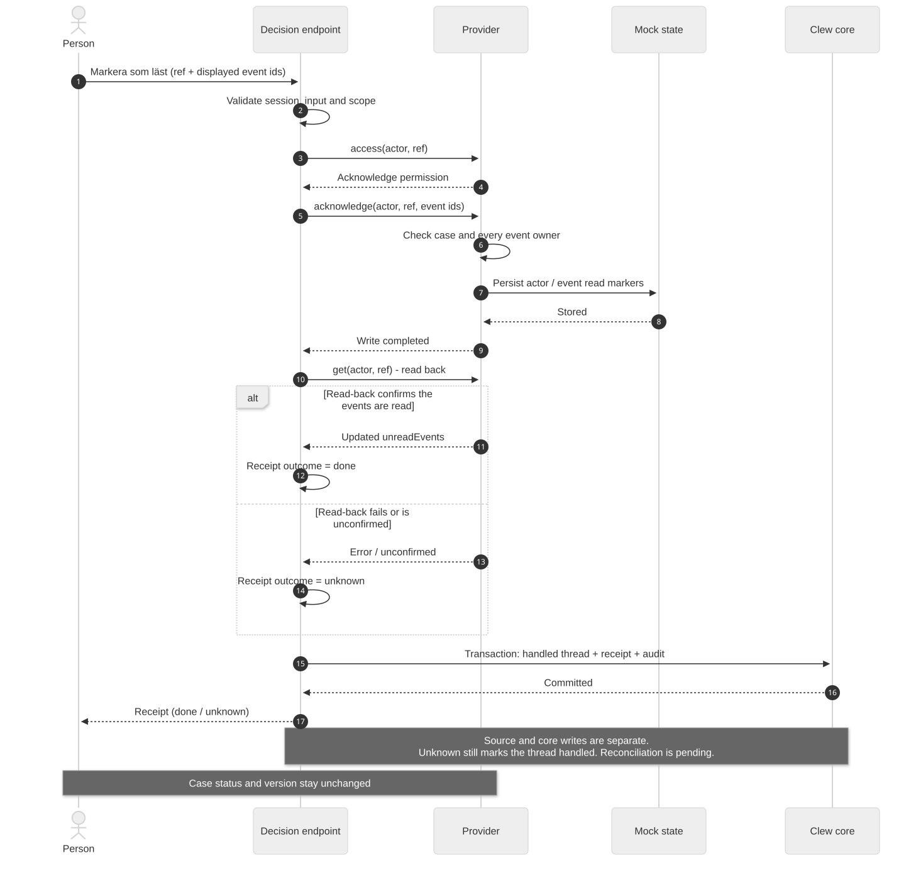

# Errands: the first mock slice

Built 2026-11-04 to make the D18 proposal tangible. D18 and D19 remain proposed: this slice does not accept
their live gateway identity design, implement webhooks, or connect to an installation.

## Ownership and flow

`packages/errands/src/model.ts` owns the first typed read contract and its TypeBox schemas. The mock
SupportManagement provider maps synthetic source-shaped records onto it. `apps/server/src/errand-module.ts`
projects that contract into the existing capability registry, thread drafts and read-back receipts.
The existing web card and side panel render it; there is no separate case-management page or card renderer.

[PNG figure](diagrams/errands-flow.png) · [Editable Mermaid source](diagrams/errands-flow.mmd)

The boxes describe logical ownership, not separate deployed services. The mock acknowledgement store is
the existing `module_state` table in Clew's development Postgres. It simulates the read markers a real
source would own. Controlled card text and refs are persisted by the existing thread flow; source bodies
are excluded.

The source fixtures are based on the reviewed SupportManagement API at `a530b0f`. They model a subset, not
a full wire-compatible API: the errand has source field names, classification, source status codes,
phase history, assignee, reporter, suspension and version. Investigations and communication are separate
fixture reads. Handler notifications and reporter subscription events have separate owners. Only the
communication projection is simplified for this demo. Status codes and metadata are synthetic namespace
configuration, not a claim about the production KC namespace.

## The read contract and why each field exists

| Field | Purpose |
|---|---|
| `ref` | Stable identity across systems, municipalities and namespaces: `errand:<adapter>:<municipalityId>:<namespace>:<id>`. |
| `errandNumber` | Human-readable recognition without copying the source title. |
| `category`, `type` | Controlled metadata for a useful list/card label. |
| `status.code`, `status.label`, `status.closed` | Preserve the source's vocabulary, display its label and distinguish a closed case from a read event. There is no universal status enum yet. |
| `phase` | The display name of the active entry in the source's phase history. |
| `relationships` | Handler and reporter are separate relationships; a manager role alone grants no access. |
| `waitingOn` | Source-derived explanation of what is pending; Clew uses it to draw its own waiting thread. |
| `suspendedUntil` | Source parking time, kept separate from a task deadline and a personal Clew reminder. |
| `deadlines[]` | Each entry names its task through `ref`, a controlled `label` and `dueAt`. Investigation free-text titles are not copied. |
| `unreadEvents[]` | Only this actor's unacknowledged source events: id, controlled label and observed time. |
| `version` | Opaque source revision, retained for the future version-checked mutation path. Acknowledging an event does not change it. |

`ErrandDetail` extends the summary with `title`, `description` and `lastCommunication`. These are live
detail fields only. They are excluded from thread drafts, list outputs and model tools. The detail view
does not contain stakeholder names; whether such names may be rendered remains a separate open decision.

The provider supports `mine`, `reported`, `get`, `access` and `acknowledge`, plus its source label and an
account-availability check. This is deliberately a subset of the D18 operation list. There is no adapter
selector until a second source exists. The module's list/detail schemas are presentation projections;
they do not replace the canonical provider model. List rows use the existing `ViewRef` contract for
drill-down, rather than putting frontend URLs in the provider.

[PNG figure](diagrams/errands-model.png) · [Editable Mermaid source](diagrams/errands-model.mmd)

The figure emphasizes field names and nested structures; the TypeBox/TypeScript contract defines the
exact types. Phase, waiting reason, suspension time and last communication may be null. `ErrandDetail`
includes all summary fields. Empty deadline/event lists are valid. Relationships (`handler`, `reporter`,
or both) and unread events are computed for the requesting actor, so this is an actor-scoped read
projection. `ErrandAccess` is evaluated separately; a manager role alone grants no case access.

## What to inspect in the application

Sign in with an existing synthetic persona, open **Ärenden**, and use **Ärenden jag handlägger** or
**Ärenden jag har anmält**. Each list row opens the detail view. The examples are deliberately fixed to
the 2026-11-04 demo date:

| Persona | Errand | Scenario |
|---|---|---|
| Hillevi | KC-26110001 | Assigned premises errand, unread investigation event, investigation due 6 November. |
| Hillevi | KC-26110002 | Reported IT errand, waiting for a response, source parked until 10 November. |
| Hassan | KC-26110003 | Assigned premises errand, unread incoming message, no deadline. |
| Hassan | KC-26110004 | Reported IT errand, solved in the source, unread response through a subscription. |

These are demonstration assignments, not new entitlements for the personas in a real installation.
The mock binds the two Clew ids explicitly to demo AD accounts and `unit-skola`. Other identities or
units receive no fixture records. Source access is checked again for details and acknowledgement.

An unread event creates a **Behöver dig** thread. An open reported errand without an unread event creates
a **Pågår utan dig** thread. Marking an event as read removes that event's draft on subsequent scans,
while the case remains in its list with the same status/version. A future event has a different thread
topic. Deadlines annotate these event cards; deadline-only alerts and automatic reconciliation of
changed/disappeared source threads are outside this slice.

**Markera som läst** acknowledges exactly the event ids the card displayed. Ownership is validated before
any state is written. Each acknowledgement is stored under its own actor/event key in the existing
mock state store, so rebuilding the provider or restarting the server does not lose it. No errand body is
stored. The human decision endpoint records the receipt/audit through the existing flow; a failed
read-back yields `unknown`. There is no undo or status-changing capability in this slice. The generic
demo reset clears these acknowledgements along with the other mock state.

[PNG figure](diagrams/errands-acknowledgement.png) · [Editable Mermaid source](diagrams/errands-acknowledgement.mmd)

The figure exposes two existing-flow limits: source/mock writes and the core transaction are separate,
and an `unknown` receipt still leaves the thread handled. Per-event acknowledgement writes are idempotent,
but automatic reconciliation after an ambiguous outcome or a failed core transaction is not implemented.
These limits must be settled before treating the flow as production case handling.

## Design tradeoffs for review

| Choice in this slice | Benefit | Cost or question for reviewers |
|---|---|---|
| One Clew-owned contract behind a source adapter | UI and workflows can outlive the first source API. | Is this sufficient for CaseData and a third-party system? Validate with a second source before expanding it. |
| Retain source status code, label and a closed flag | Avoid imposing a premature universal workflow. | Which shared filtering/reporting needs would justify normalized states later? |
| Actor-specific relationships and unread events | Handler and reporter views use the same model without equating their permissions. | Group queues and real directory/IdP mapping are not proved by two demo bindings. |
| Controlled metadata in cards; free text only in detail | Limits source-text persistence and model exposure. | Are number/category/type enough for people to recognize their work? Stakeholder names and classified text need a separate decision. |
| Named task deadlines, source suspension and personal reminders are separate | A due investigation is distinguishable from a parked case or a Clew reminder. | The UI currently shows the nearest task deadline; multiple simultaneous deadlines need usability review. |
| Event acknowledgement before status-changing actions | Demonstrates the human decision and read-back loop with a small effect. | Unknown outcomes, cross-transaction failures and stale waiting/event threads still need reconciliation. |

The user approved a mock-first experiment. This PR does not settle D18's gateway identity risk, the D10
native-contract-versus-adapter policy, or D19's notification delivery design. The mock adapter is a seam
for evaluating those decisions, not evidence that a live source meets the contract.

## Validation and next boundary

Focused tests: `tests/unit/errands.test.ts` covers identity isolation, field mapping, source-text exclusion,
waiting versus unread work, persisted acknowledgements and unknown read-back. The panel label tests also
cover the new view outputs and drill-down metadata. `tests/a11y/errands.spec.ts` adds keyboard drill-down,
focus continuation, a waiting card's read action, axe and 320 px reflow checks. Browser tests require
explicit execution authorization under the local resource rules; adding them does not claim they ran.

Before a real adapter: verify reporter identity and namespace access against a test installation, confirm
which fields each role may read, and resolve the source-versus-Clew adapter policy. Then add version-checked
case mutations and receipts one operation at a time. CaseData should test the contract's generality before
adding further generic fields. D19 change notifications remain a separate implementation.

## Diagram sources

The `.mmd` files are the editable diagram sources; SVG and PNG files are checked-in exports for readers
who prefer figures or need to reuse them outside GitHub. They were rendered with
`@mermaid-js/mermaid-cli` 12.2.0 (MIT), a light theme, white background and a 2x PNG scale, using the existing
local Chrome through the global resource supervisor. No rendering dependency was added to the application.
