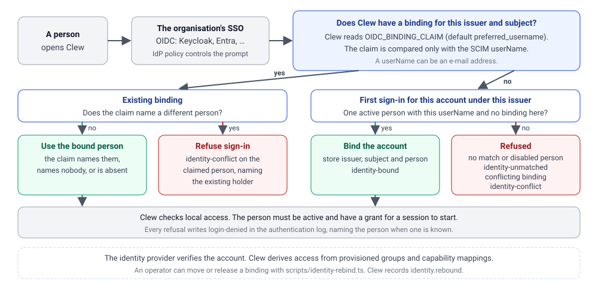
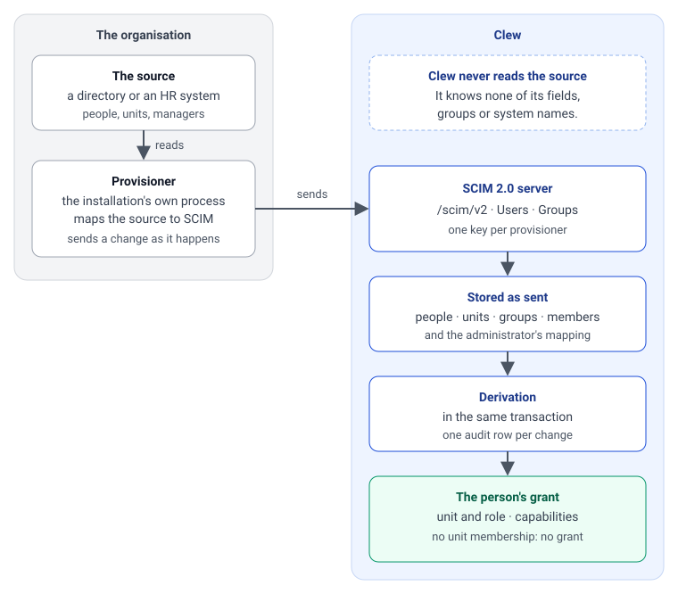
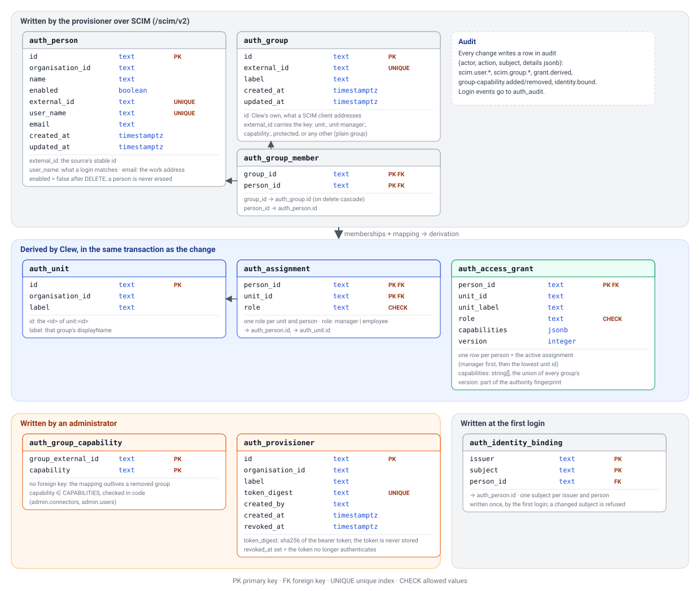
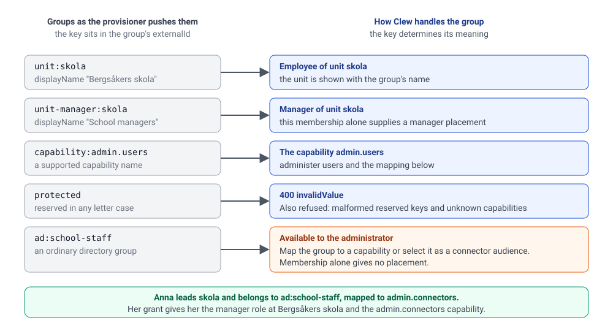

# Identity and authorization

Clew separates **login identity**, **local permission**, **connector authority** and **source credentials**. Passing one boundary does not bypass the next. This page describes the current implementation; exact connector claims and verification instructions are in [Authorization](../guides/authorization.md).

## Browser to Clew

The [authentication implementation](../../apps/server/src/auth.ts) uses OIDC Authorization Code with PKCE. Development uses Keycloak. The server keeps tokens sealed in its database; the browser receives an opaque, HttpOnly session cookie and the session's CSRF token for mutations.

Login validates state/nonce and resolves the verified issuer and subject through an existing local identity binding. A subject seen for the first time binds to the one enabled, provisioned person whose `userName` equals the ID token claim named by `OIDC_BINDING_CLAIM` (default `preferred_username`), with an `identity-bound` row in the authentication log and an `identity.bound` audit row on the person (D68 item 6, `bindFirstLogin` in `packages/db/src/auth.ts`). No match, two matches, a disabled person, or a subject that differs from the person's existing binding is a denied login, audited as `identity-unmatched` or `identity-conflict`; a changed subject needs a person's review, never an automatic rebind. The person must have a local access grant. A matching display name or e-mail is never a substitute. Login does not create a user on demand.

The current session policy has eight-hour idle and absolute limits. Mutation requests check the allowed origin and CSRF token; back-channel logout validates the identity provider's signature. The authoritative behavior is in [auth.ts](../../apps/server/src/auth.ts), [auth-origin.ts](../../apps/server/src/auth-origin.ts) and [database authentication helpers](../../packages/db/src/auth.ts).

## Clew's local authority

An authenticated context carries the person, organisation, current unit/role, grant capabilities, the external ids of the person's provisioned groups, the authorization version and the session binding. Its `authorize()` rechecks the current grant/session rather than trusting an earlier UI response. The authorization version is a fingerprint of the authority alone (enabled, organisation, unit, role, capabilities, grant version); names, labels and other columns do not change it, so durable work survives directory updates. See the [operations runbook](../maintainers/reliability-operations.md#changing-the-authorization-fingerprint).

Connector governance further narrows access by enabled state, audience, capability switches and tool/scan/figure settings. An audience names roles, units and provisioned groups ([D23](../decisions/D23-connectors-are-managed-in-the-database.md), [D68](../decisions/D68-people-are-pushed-into-clew-through-standard-scim.md)); the groups are read at each request and for background work, so a membership the provisioner removes stops matching at the next check.

Users and grants are core entities ([D62](../decisions/D62-users-are-core-entities-not-connected-systems.md)). Their internal `people.*` reads share dispatch but cannot be disabled as a connected system. They describe Clew's users, not the full employee directory.

## Provisioning

People, units and groups enter an installation through Clew's SCIM 2.0 server at `/scim/v2` and in no other way (D68; `apps/server/src/routes/scim.ts` over `modules/people/usecases.ts`). A **provisioner**, the installation's own process, reads the organisation's source and pushes; Clew never reads the source and never learns its name ([guide](../guides/writing-a-provisioner.md)). The server offers `Users` and `Groups` with `POST`, `GET`, `PUT`, `PATCH` and `DELETE`, `filter` as one equality (`userName`/`externalId` on users, `externalId`/`displayName` on groups), `startIndex`/`count` paging and the discovery resources; bulk, sorting and ETags are not offered. A provisioner authenticates with a bearer token whose digest Clew holds (`auth_provisioner`, issued and revoked with `bun scripts/provisioner-token.ts`); users are scoped to the token's organisation, groups belong to the installation. Every mutation writes its `scim.*` audit row and re-derives the grants it touched in the same transaction. `DELETE` on a user deactivates, never erases. The answers are English: a machine reads them.

The data model (`packages/db/src/schema.ts`): `auth_person` carries the source's `externalId`, the `userName` a login is matched on and a work e-mail (empty on rows from before provisioning); `auth_unit` the organisation's units; `auth_assignment` any number of (unit, role) pairs per person with the two roles `manager` and `employee`; `auth_group` and `auth_group_member` every pushed group as pushed, with Clew's own id, the source's optional `externalId` and its name as `label`; `auth_group_capability` the administrator's mapping from a group to a capability of the closed list `CAPABILITIES` in `@clew/contracts` ([D85](../decisions/D85-capabilities-are-mapped-from-provisioned-groups-in-clew.md)); `auth_provisioner` the clients, by the digest of their token.

## Derivation

`auth_access_grant` is a projection of those tables: the one active assignment (manager before employee, then the lowest unit id) and the person's capabilities, which is what the authenticated context and the connector actor carry. Meaning comes from keys in a group's `externalId` (`unit:<id>`, `unit-manager:<id>`, `capability:<name>`, `protected`) and from the mapping; a person with no unit membership has no grant, so a mistake fails closed. The derivation is `deriveAuthority` in `modules/people/domain.ts` (pure) and `provisioningUsecases` in `usecases.ts`: called inside the transaction that changed a membership or a mapping row, it rewrites the person's units, assignments and grant and writes one `grant.derived` audit row only when the grant changed, or `removed: true` when the person has no unit left.

In development the provisioner is `scripts/provisioner/`: `bun run auth:setup` creates the Keycloak accounts, the person rows with the ids the fixtures and calendars key on, and the provisioner's token, then pushes the directory through the SCIM routes in-process; `bun run dev:provision` does the same over HTTP. Units, assignments, grants and capabilities in development come from that push and from nowhere else.

## Administration › Användare

The page (`apps/web/src/pages/admin/users.tsx`, behind `admin.users`) shows the provisioned people with unit, role, capabilities, groups and whether they have signed in, and holds D85's mapping from a group to a capability. Adding or removing a row steps up, writes `group-capability.added`/`removed` and re-derives the group's members in the same transaction. It edits no identity: who exists and where they belong is the source's.

## Clew to a connector

Protocol 2 requires both:

1. `X-Clew-Connector-Key`: the per-registration transport secret.
2. `Authorization: Bearer ...`: a short-lived RS256 assertion signed by Clew, bound to the connector's audience and the acting person.

Only Clew holds the signing private key. The connector pins its trusted Clew base URL and fetches public keys from `/api/connectors/jwks`. It takes the actor from verified claims, never from an unverified body. The transport secret cannot sign identity.

The connector still maps that actor to the source's person/unit and enforces record-level access. Clew's `manager` role is not permission to read every source unit. A ref is not an access token.

See [the verifier](../../connectors/hello/verification.mjs), [signing authority](../../apps/server/src/connectors/authority.ts) and [authorization guide](../guides/authorization.md) for key rotation and exact claims.

## Connector callbacks

A connector declares exact target capabilities in `uses`. Clew can include a separate callback grant in the verified assertion. The connector sends that grant, not the original assertion, to `POST /api/connectors/call`.

Clew reconstructs current person/assignment access, checks origin and target governance and declared dependencies, and refuses executes, cycles and chains beyond the supported bound. A callback grant is short-lived request authority, not a credential for a later background job.

## Source authentication and background work

A source can use a service credential narrowed to the actor, a bound personal credential or an audience-bound delegated token. The Clew assertion does not itself authenticate to the source.

For interactive calls, a connector declaring `delegation` can receive `X-Clew-Delegated-Token` after session-backed IdP token exchange. The source must accept that issuer/audience and enforce its own permissions.

Background work uses [systemContext](../../apps/server/src/system-context.ts), built from the person's current local grant. It carries no session tokens. Scans, figures and callbacks do not receive a delegated token. Generic durable execution records a connector declaring delegation as needing a session and can remain pending with `needs-session`; there is no complete sign-in-and-resume action path.

A valid delegated search therefore does not prove the source can support unattended scans, watches or actions. Establish and test the source's background authorization arrangement before enabling those features.

## Retained data and revocation

Clew rechecks authority before releasing protected results. Persisted source cards/messages retain the authority that produced them; a new unit assignment or renewed grant does not make the old snapshot readable. Legacy snapshots without provenance are hidden, and fresh scans create new authorized projections.

Source-only permission changes still need an explicit revocation path into Clew's grant or connector access before persisted scans are enabled. Live source reads must enforce current source permissions too. The browser clears retained state on authorization changes, but data already delivered cannot be recalled.

See [D75](../decisions/D75-source-snapshots-retain-the-authority-that-produced-them.md), [shared authorized reads](../../apps/server/src/threads/access.ts) and [authorization tests](../../tests/unit/authorization-boundaries.test.ts).

## What is not built

- Switching between several assignments: a person with more than one acts as the deterministically chosen one.
- Storing or applying the `protected` membership (D68's open question whether Clew may hold that fact at all).
- A real provisioner against a real source, and a real identity provider's claim for `OIDC_BINDING_CLAIM`; the development stack's Keycloak and synthetic directory are the only ones that have run.
- An organisation scope on groups (one organisation per installation is assumed), and a way for a connector to map the acting person beyond Clew's id: protocol 2's `Actor` carries neither `externalId` nor `userName`.
- Local dev-login without the IdP ([D6](../decisions/D06-dev-login-local-only.md)), a public MCP OAuth surface and cross-domain ID-JAG exchange ([D5](../decisions/D05-oidc-and-oauth-only-identification-path.md)).

The early rationale is in the [identity decisions](../decisions/D05-oidc-and-oauth-only-identification-path.md) and the [SCIM review](../reviews/2026-11-06-users-groups-roles-and-scim.md); use the [status matrix](../reference/status.md) for support.
