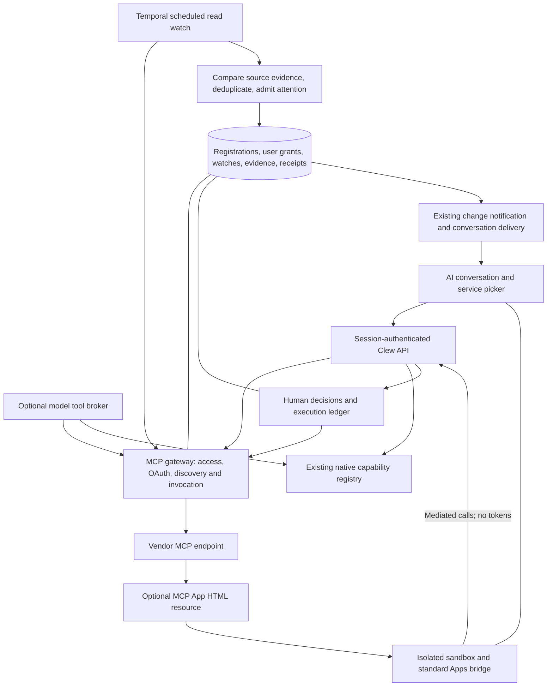

# MCP services in AI conversations

Direction agreed 2026-11-08, [D81](../decisions/D81-mcp-apps-extend-ai-chat-with-provider-owned-interactions.md). The runnable lab is a synthetic prototype, not a production MCP host. Hillevi Berg at Bergsåkers skola is its target persona. Existing MCP providers must not need a Clew manifest or a custom integration.

## Two integration lanes

| | Native connector | Standard MCP service |
|---|---|---|
| External contract | Clew manifest and connector HTTP protocol | MCP discovery, tools, resources and optional Apps extension |
| Presentation | Clew's semantic view catalogue and Astryx | Text/structured tool results; provider HTML when a standard MCP App is advertised |
| Available without a model | Yes | No, by Clew product policy |
| Work coordination | Native scans, capabilities, jobs, decisions and receipts | Conversation tools/apps; optionally an approved read watch |
| UI responsibility | Clew | Clew around the interaction; provider inside the app |
| Source authorization | Connector authority and its source adapter | Provider OAuth and per-user permissions, intersected with Clew policy |

This is not a split between essential and non-essential services. Both may handle sensitive data. It distinguishes work Clew coordinates across systems from a provider-owned interaction. A provider may support both paths. A custom view that does not fit Clew's catalogue is a valid reason to choose MCP Apps; enlarging the catalogue is not a prerequisite.

## Architecture placement

The `apps/server/src/mcp/` boundary follows D20/D25: contracts/domain, use cases with injected ports, protocol adapters and composition wiring. Thin MCP routes call these use cases. No module imports another module. The development slice implements the unauthenticated mock transport; production adds OAuth here, keeping tokens out of the browser/model. MCP registrations are distinct from connector manifests; administration can eventually present both under connected services.

The assistant's tool broker combines the permitted native tools with permitted MCP tools. Preserve each vendor tool name and schema; use an internal collision-free mapping from model-safe names to registration + original tool name. Do not force MCP schemas into Clew capabilities or reuse the current dot-replacement mapping blindly. The native registry is not a protocol converter.

MCP app references become a separate conversation attachment type, not a foreign `ViewSpec`. Persist the registration, originating tool invocation, resource URI, safe summary and source identity. Recheck access on reopen; fetch the current resource or retain a bounded, integrity-checked version under an explicit retention policy. Do not persist arbitrary executable HTML in ordinary chat messages. Separate model-facing `content`/`structuredContent` from UI-only `_meta`.

The existing execution ledger, current-authority checks, transactional audit/outbox and Temporal are reusable infrastructure, not evidence that MCP execution already works. The ledger currently dispatches native connector actions. It needs an explicit MCP target/port and immutable approval record before generic MCP mutations can use it. Never invent idempotency, read-back, compensation or undo for a vendor tool. After an ambiguous network failure, preserve an unknown outcome until evidence establishes what happened.

## Follow the standards at the provider boundary

The development client uses the official `@modelcontextprotocol/sdk@1.32.2` (MIT, checked before pinning), including initialization, paginated discovery, Streamable HTTP, tool calls and resource reads. The browser bridge implements only the documented fixture subset; the production Apps host still needs the official Apps SDK and a dedicated sandbox origin.

1. Connect to a registered remote MCP URL with Streamable HTTP. Negotiate the protocol/capabilities and support paginated `tools/list`, `resources/list` and `prompts/list` when advertised. Follow change notifications and invalidate cached descriptors. Legacy HTTP/SSE compatibility is a deliberate compatibility option; local `stdio` servers require separately managed deployment and are not arbitrary commands entered in a shared web app.
2. Implement the MCP authorization flow, protected-resource/authorization-server discovery and OAuth authorization code + PKCE. Support administrator-provided client IDs/secrets as well as the registration methods the server advertises. Lattice and Qualtrics demonstrate why manually registered OAuth clients must work. Use redirect/state validation, resource/audience binding, encrypted server-side tokens, refresh/revocation and per-user account binding. Clew's own login is not automatically a credential accepted by a vendor. No silent fallback to an owner-level token.
3. Build the service catalogue from standard discovery. Tool titles, descriptions, schemas and annotations help presentation; they are not permission grants. Apply organization audience/tool policy and conversation enablement before exposing tools to a model. `readOnlyHint` is a hint, not a sufficient basis for background approval.
4. Negotiate `io.modelcontextprotocol/ui`. A tool with `_meta.ui.resourceUri` refers to a `ui://` resource retrieved with `resources/read`, using `text/html;profile=mcp-app`. Recognize the SDK's legacy `_meta["ui/resourceUri"]` alias as well. No app metadata means a normal tool; absence of UI must not block use.
5. A web host uses a separate-origin sandbox proxy, constrained resource CSP and an inner sandboxed view. Apply only admitted permissions/domains, validate message sources, complete `ui/initialize`, then send tool input/result in the standard order. Supply theme, locale and display-mode context. Use the documented bridge lifecycle and only advertise methods actually implemented.
6. App tool calls go back through the same Clew authorization boundary, restricted to their service, invocation and admitted tool set. `visibility: ["app"]` hides tools from the model but does not authorize a write. Bind human approval to exact target/arguments and recheck current access before dispatch. Handle link opening, context updates and model-message requests explicitly; do not blindly forward every JSON-RPC method.

Standard MCP Apps are the baseline. A proprietary host API such as `window.openai`, or the label “ChatGPT app”, does not alone establish MCP Apps interoperability. Unsupported host-only features need an honest fallback. Standard protocol support also does not guarantee access to every provider: customer plan, allowed OAuth clients, region and endpoint capabilities still apply.

## How Hillevi finds services

The chat composer offers **Tjänster i samtalet**. It lists services Hillevi is allowed to discover, their purpose, connection state and whether an interactive view is available. Organization availability, Hillevi's provider login, and enablement in this conversation are different states. Reconnection uses the provider's OAuth page; Clew never asks her to paste a token into the chat.

An interactive result carries provider attribution and a close control. Clew owns loading, rejection, unavailable and receipt states around it; provider code owns its inner controls. A tool-only result is shown in ordinary conversation content. Do not represent an approved service as a built-in Clew screen. No app or background read continues after AI access, audience, provider authorization or the relevant watch is revoked. An outage of the configured model is a separate runtime failure; it must not cause tools to fall through to an ungoverned router.

The developer route now uses the real Clew session and current model configuration. `scripts/dev-mcp.ts --person hillevi` registers both mock providers for the existing synthetic Hillevi account in Postgres. Neither the page nor the server gateway checks a name or imports provider fixtures. Home renders each delivery as an existing-style work card below the composer, with source, timestamp and a prominent opening link. `/chat/services` is the catalogue (`/labs/mcp` is a protected alias). `/chat/services/:id?delivery=:deliveryId` opens only the selected card; the catalogue and other messages are absent. The backend checks the delivery belongs to the person and connection and compares its source identity before loading an App. An older notice stays readable with a separate link to the latest state. Service inclusion per ordinary conversation and OAuth reconnection remain future work.

## Proactive delivery without a custom provider protocol

The initial delivery mechanism is a **Clew-owned read watch**, configured when an admin adds a service or later. Vendor-initiated push can be deferred. Temporal wakes the watch and invokes existing MCP reads with the authorized person's provider credentials. No model is required merely to perform a known read or compare evidence.

A watch binds the registration, audience/person, approved read tool, validated arguments, interval/time zone, notification rule, destination and authorization/configuration revision. Its result rule is local host configuration, not a manifest the vendor must supply. Example rules:

| Watch | Read | Comparison | Attention |
|---|---|---|---|
| Hillevi's weekly poll | Existing tool that exposes her pending invitations | Stable invitation ID + unanswered state + expiry | Once for a newly eligible invitation; no repeat after an answer |
| Email availability | Existing service-status tool | Service + incident ID + material state | Notify on degradation and recovery; stay quiet on unchanged health |

An interval alone cannot define meaning. A provider may expose only analytics, or omit stable identities/status. Then scheduled “new work” detection is unsupported until an admin-tested rule can interpret an existing result. Basic interactive MCP use remains available. For free-text-only results, exact hashes are often noisy; do not label every timestamp change an incident. An optional model-assisted rule needs its own bounded budget and review, not an automatic assumption.

Persist watch intent, absolute next check/generation, comparison evidence and unique delivery identity transactionally with audit/outbox. Reuse Temporal scheduling and attention limits; avoid a workflow/session per idle browser. Recheck AI entitlement, audience, tool policy and provider authorization at every tick and before releasing the result. Retry safe reads with bounds; failures do not mean recovery or absence. Refresh tokens only as permitted by the provider; pause and request reconnection when background authorization is unavailable. Startup, revocation, expired invitations, partial results and configuration changes need explicit behavior.

Deliver a small attributed invitation/update into an AI-enabled service conversation with an unread indication, linked from Clew's existing attention surface. Do not silently inject it into an unrelated active conversation or mount third-party HTML automatically. Hillevi opens the invitation, and only then does Clew load the MCP App with current authority. A watch can reference a service before Hillevi has started a chat; it creates or reuses a designated service conversation rather than requiring her to ask first. Conversation enablement and separately approved watch authorization must not be conflated.

Resource subscriptions may later trigger an early re-read when a provider supports them. A standard resource-change notification is a hint to refresh, not a durable domain event, a poll payload, or permission to notify every person. Optional replay/SSE does not replace Clew's durable evidence and deduplication.

## Scope of the runnable mock

Open `/chat/services` (or `/labs/mcp`) while signed in to the registered development account. Production builds omit these routes unless explicitly built with `VITE_MCP_PREVIEW=true`; the backend additionally requires `CLEW_POC=true` and refuses production. The dedicated browser test build opts in.

- **Medarbetarpuls:** a synthetic vendor's standard tool catalogue, `ui://` HTML resource, Apps initialization/input/result exchange, app-only answer tool, Clew confirmation and minimal receipt. An independently runnable local provider is under [fixtures/mcp-pulse](../../fixtures/mcp-pulse/README.md).
- **Driftkollen:** a synthetic tool-only result, unchanged-state suppression, outage and recovery updates, no user question required.
- **Registration:** an explicit person, endpoint, read/write allowlists and watch policy in Postgres, with an audit entry. The CLI seeds only connection policy. Tool titles, descriptions, results and HTML come from the independent services over MCP. No provider manifest or Clew-specific provider API is used.
- **Delivery:** a real Temporal workflow per registered watch, current authority/model checks on every read, structured-content JSON pointers for novelty/eligibility, persistent deduplicated delivery rows and transactional audits. The development default checks every 30 seconds for a visible demonstration; configure a weekly interval with `--interval 604800` on initial registration. The home/inbox refresh every ten seconds. The workflow reads even with every browser closed.
- **Interaction:** the App is fetched on opening, after an authorized read. The host validates tool arguments against discovered schemas and the operator's write allowlist, records a human decision before dispatch, and stores an encrypted receipt. Repeating the same decision replays its receipt; an uncertain outcome does not automatically retry. This is a small development decision store, not a replacement for the production execution ledger.
- **Limitations:** providers have one synthetic identity and in-memory source state; no vendor OAuth is implemented. Admin UI, normal AI tool routing/conversation opt-in, unread/acknowledgment and attention-budget integration, invitation expiry, production watch revisions/backoff/revocation lifecycle, full MCP Apps bridge and vendor certification remain unfinished. These services must stay behind the development gate.
- The iframe exception is limited to these registered synthetic providers. Its opaque-origin proxy, restrictive CSP, fixed height and restricted bridge demonstrate separation; a dedicated origin, full lifecycle, request budgets and compatibility matrix remain production work. The provider's form is deliberately visually distinct; accessibility is verified for this fixture only. The private design canvas could not be accessed during this session, so the mock follows existing Astryx composition rather than claiming a canvas comparison.

## Trace the implemented external path

The sequence below describes the runnable development implementation. The architecture diagram above also includes planned production responsibilities.

1. **Register host policy.** An operator runs [dev-mcp.ts](../../scripts/dev-mcp.ts) with an existing person id. The script discovers the independent endpoints and stores their URLs, allowed reads/writes and watch rules in `mcp_connection`. It does not insert a poll, outage message or HTML. The development CLI knows the two fixtures; the application gateway does not.
2. **Read without a question.** [Composition](../../apps/server/src/composition/mcp.ts) reconciles enabled registrations into [Temporal workflows](../../apps/server/src/temporal/workflows.ts). Each tick passes only a registration id to the activity. The [use case](../../apps/server/src/mcp/usecases.ts) resolves current person/model access and calls the configured tool through the [official MCP HTTP client adapter](../../apps/server/src/mcp/adapters/http.ts).
3. **Turn changed evidence into a card.** The watch extracts configured JSON pointers from `structuredContent`. The poll uses its invitation identity and unanswered condition; status uses service/incident/state, with a quiet initial baseline. The [Postgres adapter](../../apps/server/src/mcp/adapters/postgres.ts) records comparison evidence and deduplicates `mcp_delivery` with audit in the same transaction. Repeated reads of unchanged source state do not create more cards. These rows are MCP delivery records, not native work items with implied dismissal, undo or job semantics.
4. **Expose the available services and deliveries.** Session-protected [routes](../../apps/server/src/routes/mcp.ts) return the person's catalogue and inbox. [Home](../../apps/web/src/pages/start.tsx) draws each delivery using [ServiceCard](../../apps/web/src/components/service-card.tsx), composed from existing Astryx components. The catalogue remains available separately. AI-disabled requests return no available services and cannot read an App or invoke a tool.
5. **Open exactly one delivery.** [The service page](../../apps/web/src/pages/chat-services.tsx) uses the connection and delivery ids in its address. The gateway checks ownership and compares the delivered identity with the current tool result. Matching App metadata leads to `resources/read` and the [sandboxed Apps bridge](../../apps/web/src/labs/mcp/app-frame.tsx); a tools-only result uses Clew's notice component. A changed identity leaves the original notice visible with a separate latest-state link. HTML is fetched only on opening.
6. **Confirm a source write.** An App's `tools/call` request opens Clew's confirmation. The human endpoint validates current access, the tool allowlist and discovered input schema, then claims an immutable `mcp_decision` before dispatch. It stores an encrypted result and audit metadata. A repeated confirmed decision replays its stored result; an ambiguous result stays unknown. The provider receives an ordinary MCP tool call, without a Clew protocol envelope.

The [fixtures and run instructions](../../fixtures/mcp-pulse/README.md) demonstrate this with two separate HTTP services. Their control endpoints only change synthetic source state; they never deliver cards directly. [Use-case scenarios](../../tests/unit/mcp-host.test.ts), [HTTP interoperability](../../apps/server/tests/mcp-runtime.test.ts), [Postgres scenarios](../../tests/db/postgres-mcp-store.test.ts) and [browser scenarios](../../tests/a11y/mcp.spec.ts) cover these boundaries.

## Real-provider evidence

See the [provider review](../reviews/2026-11-08-mcp-services-and-provider-compatibility.md). Existing providers validate the value of a standard client and per-user OAuth. The exact combination of pending polls plus a provider-supplied MCP App is not established by their public documentation. The poll is an interoperability demonstrator, not a claim that every survey SaaS offers that flow today.

Sources: [MCP Apps specification](https://github.com/modelcontextprotocol/ext-apps/blob/main/specification/2026-01-26/apps.mdx), [MCP transport](https://modelcontextprotocol.io/specification/2025-11-25/basic/transports), [resource notifications](https://modelcontextprotocol.io/specification/2025-11-25/server/resources), [metadata compatibility](https://apps.extensions.modelcontextprotocol.io/api/variables/server-helpers.RESOURCE_URI_META_KEY.html).
