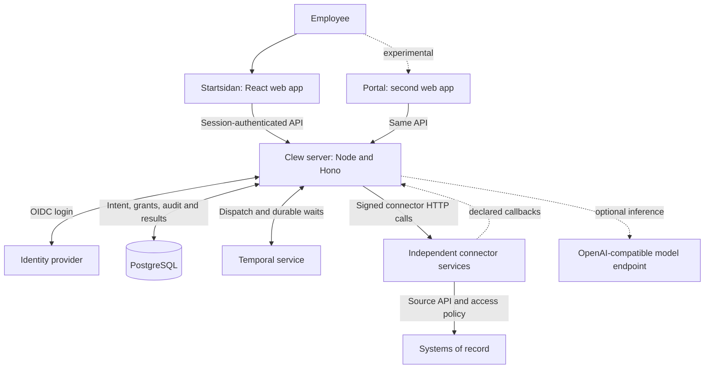
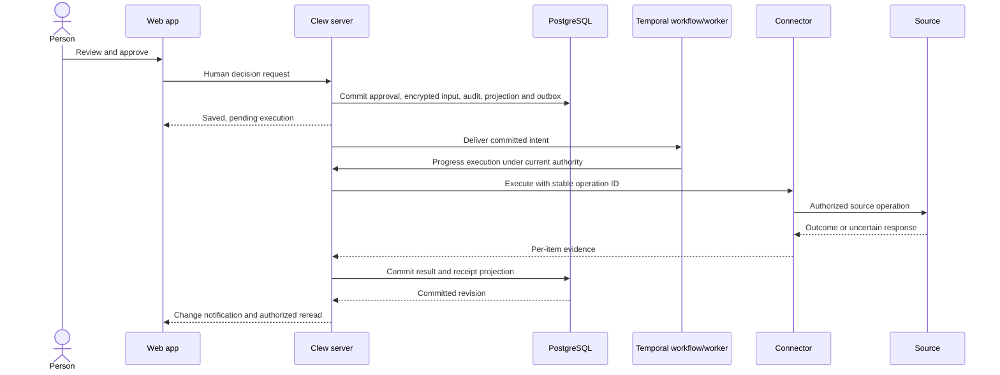

# How Clew works

Clew is a **modular monolith with independent connector services**. Its backend keeps coordination in one application, with explicit modules and replaceable adapters. External integrations run as separate HTTP services so a source owner can use its own language, network and release cycle.

A central responsibility of that backend is carrying one person's task across several systems: collect the required changes into a proposal, record one approval, execute each connector's part, watch for results and bring dependent work back for review. The fact-and-follower model below separates the implemented job machinery from the planned continuation and interfaces.

This is the current architecture, checked against the repository on 2026-11-07. Read [What Clew is](../overview.md) for the product concepts and [implementation status](../reference/status.md) for feature-specific limits.

## Running components

| Component | Responsibility | Location |
|---|---|---|
| Web app | Employee interface, declared-view rendering, query cache and accessibility behavior. Calls Clew's API. | [apps/web](../../apps/web/) and [packages/ui](../../packages/ui/) |
| Portal | Experimental alternative frontend using the same server and shared web components. | [apps/portal](../../apps/portal/) |
| Server/BFF | Browser-facing API, identity, capability dispatch, conversations, decisions, connector/model administration and background coordination. BFF means backend for frontend. | [apps/server](../../apps/server/) |
| PostgreSQL | Authoritative Clew state: users/grants, configuration, threads, approvals, audit, source evidence and durable delivery intent. | [Database schema and migrations](../../packages/db/src/) |
| Temporal | Durable workflows for approved executions, timers, follow-up and jobs. The current server starts an embedded Node worker; the Temporal service is separate. | [Worker and workflows](../../apps/server/src/temporal/) |
| Connector | Manifest and declared operations; verifies Clew's authority and translates into the source's API. | [connectors](../../connectors/) or an external repository |
| Identity provider | Authenticates people. Development uses Keycloak; Clew keeps its own grants and identity bindings. | [Identity](identity.md) |
| Model endpoint | Optional inference. Providers/models are configured in Clew's database and administration UI. | [Assistant](../../apps/server/src/assistant/) |

Node is the server runtime; Bun is the package manager, script runner and fast test runner. The development stack also includes synthetic source services and calendar providers. Its container topology is documented in [local development](../maintainers/local-development.md), not a production deployment recipe.

## The central boundary: capabilities

A capability is a named operation with an input schema, output schema, scope and kind. The [registry](../../packages/connectors/src/index.ts) validates those contracts and applies connector governance: enabled state, audience and capability/tool switches. The server checks the person's current authority around protected work.

Clew's core calendar and composite search are in-process capabilities with managed connector registrations. Internal `people.*` reads use the same dispatch machinery but users themselves have no connector lifecycle. Every new external integration is an independently deployed service; it is not imported into the server.

For a remote connector the registry uses its stored manifest and the [HTTP transport](../../packages/connectors/src/remote.ts). A manifest describes operations and presentation, not implementation code. Administration registers the service, validates the manifest, tests it and controls its audience. Current governance is refreshed at invocation boundaries; the background configuration watcher is not the permission boundary.

The same capability can serve a button, a view and an optional model tool. Generic API calls, callbacks and model tools cannot invoke `execute`. The execution worker invokes it after a separate human approval has been recorded. See [capability surfaces](capability-surfaces.md).

## A live read

For a directory table or contact detail:

1. The browser calls Clew's capability API using its session, or the assistant selects an allowed read during that person's request.
2. Clew resolves the current person/grant, refreshes connector governance and validates the capability and input.
3. For a remote source, Clew sends the input with a short-lived signed actor assertion and a separate transport key.
4. The connector verifies both credentials, maps the verified actor to source access, validates the input and reads only the allowed records.
5. Clew validates the response and rechecks current access before releasing it. The browser renders the declared view; the assistant receives only the permitted model representation.

The browser and model never obtain a connector's source credentials. A ref returned by a previous read does not bypass the current access check.

## Discovering work without slowing the page

A **scan** is a deterministic source read that returns card drafts and occurrence identities. The page reads Clew's persisted cards while requesting a coalesced refresh. Background workers refresh sources independently under bounded concurrency and source deadlines.

An occurrence combines the person/assignment, connector, source key and recurring period. A revision identifies material change. A card's `topic` groups its presentation; it is not enough to establish source identity or completion.

Only a complete, exhausted observation or explicit removal evidence may resolve absent work. A timeout or partial scan preserves known work and reports degraded freshness. Scan results are checked against current authority and intervening card changes before being stored. Source snapshots retain the authority that produced them; a transfer or renewed grant does not relabel old history as newly authorized.

Figures in areas are separate bounded reads. They do not reuse card snapshots as evidence of current source totals. See [actions and scans](../guides/actions-and-receipts.md) and [scheduled work](scheduled-work.md).

## An approved write

An **outbox** is a database record saying committed work still needs delivery. Committing it with the approval closes the gap between saving the person's decision and starting a workflow. Temporal handles delivery and waiting; PostgreSQL remains the authority for what was approved and what outcome is known.

There is no transaction spanning Clew and an arbitrary source. A source can commit while its reply is lost. Clew retains the original operation identity and uses the connector's declared lookup/replay guarantees to recover evidence. It does not turn a timeout into success or blindly repeat an uncertain effect. Undo is a separately authorized compensating execution, not deletion of the original receipt.

Session-backed token delegation currently supports interactive reads. Generic durable remote execution does not obtain that session token: connectors declaring delegation can remain pending with `needs-session`. Establish a supported background authorization path before promising scans or durable actions. See [authorization](../guides/authorization.md) and [actions and receipts](../guides/actions-and-receipts.md).

## One task across several connectors

A **job** groups the work several systems need to do for one fact. For example, a reported absence can require two writes and a watch:

| Connector | Its part of the job | What Clew tracks |
|---|---|---|
| HR | Register the absence, if it is not already recorded | An approved execution and the source's receipt. |
| Time reporting | Mark the affected shift as absence | A separate approved execution and receipt. |
| Payroll | Read whether its own import has picked up the report | A bounded watch; Clew does not write the payroll record. |

Connectors declare the fact kinds they create and the kinds they can follow. A follower is a `propose` capability that offers steps for its own system. An administrator binds the participants; Clew asks them for proposals under the person's access and assembles one job. Missing systems remain visible in a partial proposal.

One approval commits all the job's execution/watch intents. Each write then follows the lifecycle in the diagram above, with its own operation identity, authorization, receipt and possible compensation. One failed or uncertain step does not erase another system's confirmed result.

The plan in [D55](../decisions/D55-a-job-is-assembled-from-what-connectors-follow-approved-once-and-run-per-system.md) also carries work between stages: a confirmed receipt can supply a new fact, which followers turn into the **next proposal** for the person's approval. An absence may lead to a proposal to move a meeting; an unstaffed-shift result may lead to arranging cover. This is task orchestration across connectors without requiring an operator to design a process graph.

The current API, bindings, ledger and Temporal watches support the initial job. Steps within that job are computed from the same fact and run independently; dispatch order does not express a dependency. Receipt-driven continuation, the complete job card/step-list interface and binding administration screens remain planned. [Working across connectors](working-across-connectors.md) details both the implemented path and that intended continuation.

## Timers, follow-up and browser updates

Reminder and snooze changes commit absolute due times and generation numbers. A cancelled or superseded generation cannot resurface work. Temporal waits; the activity rechecks current authority and the committed state before acting.

Bounded calendar follow-up and cross-system watch steps use the same separation between durable intent and delivery. Attention records control when discovered work is announced and prevent repeated announcements across tabs. The server sends committed revisions over authenticated server-sent events (SSE); the browser invalidates its TanStack Query cache and rereads authorized state. A change notice is not evidence that the person saw a card.

A job's watch is how Clew follows a result in a system it does not write to. It reads under the person's current authority until the expectation is seen or the approved window ends; an expired watch brings the unresolved work back to the person. See [working across connectors](working-across-connectors.md) and [scheduled work](scheduled-work.md).

## Data ownership and persistence

| Data | Authoritative owner | What Clew retains |
|---|---|---|
| Source business record | Source system | Refs plus the minimum text/results needed for cards, answers and evidence. Live details are read again under current permissions. |
| Local person and access grant | Clew; login identity comes from the IdP | Person, identity binding, current unit/role and capability grant. |
| Work and conversation | Clew | Threads, messages, occurrence state, reminders and attention records. |
| Human decision and execution | Clew | Approved input and result encrypted at rest, stable operation identity, per-item evidence and audit. |
| Connector/model configuration | Clew | Manifests, governance, health and sealed transport/provider secrets. |
| Source service credential | Connector/operator | For remote integrations, held by the connector. Built-in calendar credentials are handled by its server adapter. |
| Workflow progress and durable waits | Temporal | Workflow histories; business intent and user-visible evidence remain in PostgreSQL. |

`passthrough` means the source owns the business record. It does not mean Clew stores no source-derived data. `derived` means the connector supplies a computed result or snapshot with a defined purpose. `core` is reserved for domains owned inside Clew and is not an accepted remote manifest kind.

Stored snapshots require both data minimization and current authorization. Source-only ACL changes need an explicit revocation path into Clew's access state before persisted scans are enabled; a Clew grant version cannot discover every change in an external system. A complete production retention/export/erasure policy is not established by these fixtures.

## Code boundaries and verification

Inside the server, routes parse requests and call use cases. Use cases own authorization, transactions and audit through ports; domain functions hold pure logic. Adapters implement storage or external protocols, and the composition root wires them together. Modules do not import each other; cross-module capability calls go through the registry.

[Backend structure](backend-structure.md) maps these concepts to the current folders. Dependency and purity checks enforce the boundaries. [Testing](testing.md) separates fast memory/fixture tests from PostgreSQL, Node/Temporal and browser verification.

Clew's future MCP surface, SCIM provisioning, source change-event ingest and broader identity assignments are designs, not available integration routes. The [support matrix](../reference/status.md) and [acceptance ledger](../reference/reliability-acceptance.md) are the detailed limits. To extend the running system, continue with [Create a connector](../guides/creating-a-connector.md).
