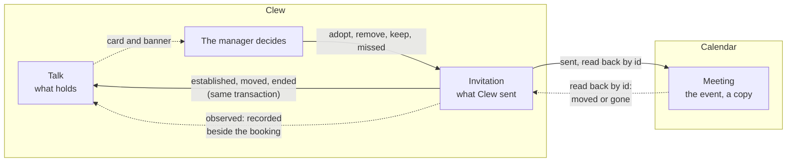

# Development talks: what is what

This page explains how a development talk (utvecklingssamtal) is built: which part owns what, how a booking comes to be, and what happens when the calendar says something else. The rules are decided in [D96](../decisions/D96-talks-is-the-first-owned-domain-the-round-and-action-points-behind-a-profile.md) (the domain), [D132](../decisions/D132-when-a-talk-is-booked-is-the-talks-own-record-and-the-calendar-holds-a-copy-of-the-invitation.md) (the booking), [D133](../decisions/D133-a-talk-follows-its-meeting-by-the-events-id-and-only-the-manager-changes-it.md) (the meeting) and [D134](../decisions/D134-a-booked-talk-reminds-its-manager-to-prepare-and-asks-afterwards-whether-it-was-held.md) (the cards); what works today is in [implementation status](../reference/status/people.md#utvecklingssamtal-talks).

## Three things, kept apart

The same three words are used in the code, on the page and here. Mixing them up is the mistake this design exists to prevent.

| Word | Swedish on the page | What it is | Who owns it | Where it lives |
|---|---|---|---|---|
| **Talk** | samtalet | What holds: when the talk takes place, whether it was held, and whose booking it is | The talks module | `talk` in Clew's database, [modules/talks](../../apps/server/src/modules/talks) |
| **Invitation** | inbjudan | Clew's record of what it sent: to whom, for when, and the id of the event it created | The calendar module | `proposal` in Clew's database, [modules/calendar](../../apps/server/src/modules/calendar) |
| **Meeting** | mötet | The event in the person's calendar | The calendar system (Nextcloud, Microsoft 365) | Outside Clew |

One direction holds everywhere: **the talk decides, the invitation carries it out, the calendar shows it.** Every page, figure and the planner ask the talk. Nothing asks the calendar whether a talk is booked, and nothing is recognised by a meeting's title.

Solid arrows change what holds. Dotted arrows only tell: what the calendar holds is recorded beside the booking and shown, and nothing changes until the manager decides.

## How a talk comes to be booked

There are two ways, and the talk's row says which (`invitation_id` is set or null; the page says "Bokat genom en inbjudan från Clew" or "Tiden är angiven här").

1. **An invitation from Clew.** The planner draws times, the manager confirms, and the invitation goes out through the execution ledger. When the calendar has been read back and holds the event Clew created, by the id Clew gave it, the execution's projection marks the proposal confirmed and tells the talks module in the same transaction. The talk is then booked by that invitation.
2. **A time set by hand.** The manager and the employee agreed on a time some other way. The manager registers it on the talk's tab. Nothing is sent and no calendar is written.

A booking counts while the manager whose booking it is still manages the person. That is asked when the talk is read and never stored, so a reorganisation writes nothing: the talk then reads as lacking a time, and the person's managers now book it again.

## How the two modules talk

Neither module imports the other. The calendar module has a port on its transaction, `invitations` ([model.ts](../../apps/server/src/modules/calendar/model.ts)), and composition binds it to the talks module's `talkInvitations` ([talk-invitations.ts](../../apps/server/src/composition/talk-invitations.ts)). Because the call is made inside the transaction that changes the invitation, the talk and its invitation commit or roll back as one.

| The calendar module tells | When | What the talks module does |
|---|---|---|
| `established` | The sent invitation was read back from the calendar | Books the talk at that time, for that manager |
| `observed` | The meeting was read back by its id, at most once an hour per manager | Records a difference beside the booking, or clears one. The booking stands |
| `moved` | The manager moved the meeting on Clew's calendar page, or took the time the calendar holds | Moves the booking and clears any difference |
| `ended` | The invitation was undone, replaced, declined, cancelled, or its time passed without a talk | Takes the time off the talk, or keeps it as a time set by hand |

## When the meeting changes

The meeting is a copy that anyone with the calendar can change. What happens depends on where the change was made.

- **On Clew's calendar page.** That is a decision made in Clew. The projection finds the invitation by the event's ref and moves or ends it, and the talk with it, in the same transaction. No second question is asked.
- **In the calendar itself.** Clew notices at the next reading back. The talk keeps its time, and the difference is shown in two sentences that keep the words apart: "Mötet i kalendern ligger nu på … Samtalet i Clew står kvar på …". The manager whose booking it is chooses: move the talk to the meeting's time, or, when the meeting is gone, take the time off or keep it without an invitation. A meeting moved by mistake is moved back in the calendar, and the next reading finds them agreeing. A meeting made all-day or recurring in the calendar has no one time to take: the talk is not moved to it until the meeting has one time again.

## The cards

The manager is told by cards in Att göra. The talks connector's scan asks for them, and each is derived from the talk's record and the clock every time. Nothing is stored for a card and no timer runs: the platform opens the card, resolves it when its cause is gone, and brings a handled one back when what it says changes.

| Card | When | Resolved when |
|---|---|---|
| Mötet … har flyttats / finns inte längre i kalendern | The meeting differs from the booking | The manager settles it, or the calendar agrees again |
| Förbered utvecklingssamtalet | The round's number of working days before the booked start (five unless the round says otherwise) | The talk starts |
| Hölls utvecklingssamtalet? | From the day after the booked time | The talk is marked held, or the time is taken off |

Only the manager whose booking it is gets them. A card names nobody: the person is the row's subject, and the card opens the person's place in the round.

## Where to look

| Question | Code | Test |
|---|---|---|
| What is a talk's state, and does its booking count? | [domain.ts](../../apps/server/src/modules/talks/domain.ts) (`talkState`, `standingBooking`) | [talks.test.ts](../../tests/unit/talks.test.ts) |
| What does an invitation do to a talk? | [usecases.ts](../../apps/server/src/modules/talks/usecases.ts) (`talkInvitations`) | [talks.test.ts](../../tests/unit/talks.test.ts) |
| How is the meeting read back and a difference settled? | [invitations.ts](../../apps/server/src/modules/calendar/usecases/invitations.ts) (`follow`, `settle`) | [invitations.test.ts](../../tests/unit/invitations.test.ts) |
| Where does the ledger tell the talk? | [projection.ts](../../apps/server/src/threads/usecases/projection.ts) (`projectOntoCard`) | [projection-contract.ts](../../tests/projection-contract.ts), [postgres-calendar-decisions.test.ts](../../tests/db/postgres-calendar-decisions.test.ts) |
| Which cards are asked for, and what do they say? | [capabilities.ts](../../apps/server/src/modules/talks/capabilities.ts) (`scan`), [domain.ts](../../apps/server/src/modules/talks/domain.ts) (`bookingAsks`) | [talks.test.ts](../../tests/unit/talks.test.ts) |
| What does the manager see and press? | [talk-overlay.tsx](../../apps/web/src/components/people/talk-overlay.tsx) | [talk.spec.ts](../../tests/a11y/talk.spec.ts) |

## What this does not do

A system other than Clew's own talks module can answer the talks profile ([D96](../decisions/D96-talks-is-the-first-owned-domain-the-round-and-action-points-behind-a-profile.md) item 9). Clew then shows that system's round read-only and records no booking of its own, and the cards above are not asked for. The record of the talk itself (preparation, notes, approval) is not built, and the employee is told nothing beyond the calendar invitation. The limits of each part are listed under "Not established" in the decisions above.
