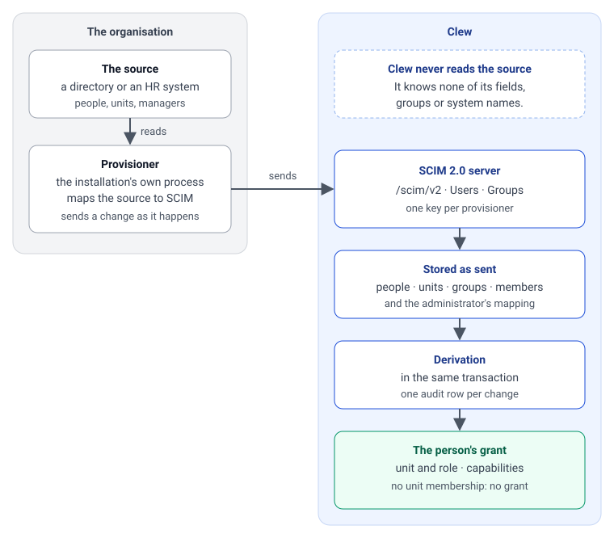

# Provisioning: what operations deliver

[This page in Swedish](../sv/guides/provisioning-for-operations.md)

This page is for the people who run an installation of Clew: the team that runs the organisation's directory, the team that runs the identity provider and the team that hosts Clew. It says what each of them delivers before anybody can sign in, what has to be answered before anything is built, and how to tell that it works. The protocol itself, every attribute and every answer, is in [Writing a provisioner](writing-a-provisioner.md).

Clew never reads an organisation's directory. People, units and groups are pushed into Clew by a **provisioner**, a process the installation runs itself, over standard SCIM 2.0. A person who has not been pushed cannot sign in, and a person who has been pushed signs in through the organisation's own identity provider.



The server side is built and tested with a synthetic directory of two hundred and fifty people. No provisioner has yet run against a real source, and no identity provider other than the development one has signed anybody in ([implementation status](../reference/status/identity.md)). The first installation that does both will find things this page does not say; tell the Clew team what they were.

## Who delivers what

| Team | Delivers | Section |
|---|---|---|
| The directory team | A provisioner: a process that sends each change in the source to Clew when it happens, and compares the whole source with Clew at least once a day | [The directory team](#the-directory-team-a-provisioner) |
| The identity provider team | A client for Clew, the claim that carries the account name, and accounts that are closed when a person leaves | [The identity provider team](#the-identity-provider-team-sign-in) |
| The hosting team | A public address over HTTPS, a proxy that lets a push through, a place for the key, the first key and a test installation | [The hosting team](#the-hosting-team-address-key-and-environments) |
| Clew's administrator | The provisioner's key, replaced or taken back on Administration › Användare | [What Clew gives back](#what-clew-gives-back) |

## Answer these before anything is built

The format fits a source that can answer yes to the first three. Each answer changes how the provisioner is written, so they come first.

| Question | Why Clew needs the answer |
|---|---|
| Does every person have an id that is stable and never given to somebody else? | Clew finds a person by it on every later push (`externalId`). An id that changes makes a new person; an id that is reused hands one person's history to another. |
| Can the units be delivered as a list of their own, each with an id, a name and the id of the unit above it? | Clew holds the organisation as a tree and never works it out from the people. A tree that exists only as a path on each person has to be turned into units in the provisioner. |
| Do unit ids survive a reorganisation? | Everything in Clew that names a unit follows the id. A unit that moves keeps its id and changes only the unit above it; a unit that gets a new id is a new unit to Clew. |
| What does the source's manager flag refer to, and where is a manager placed: on the unit they lead, or on the one above? | A manager must be pushed as manager of the unit they lead. Who a person reports to is read from that and from the tree. |
| Does a person ever have a second placement, or act as manager for a period? | Both are memberships the provisioner adds and removes. Clew holds no dates, so the period lives in the source. |
| Can the source tell the provisioner that something changed (an event, a change log, a question for what changed since a time)? | A change is sent to Clew when it happens. A source that can only be read as a whole gives a provisioner that has to compare often to come close. |
| Is an account name ever given to a new person? | A person who leaves is deactivated, not erased, and keeps the account name. The provisioner has to move it off the old row first. |
| Which claim in the identity provider's ID token carries the account name? | A first sign-in is matched on it, against the `userName` the provisioner pushed. The two must be the same value for the same person. |

## The directory team: a provisioner

A provisioner is a small program: the example in the repository, [scripts/provisioner/](../../scripts/provisioner), is about two hundred lines with a forty-line SCIM client. Replace its reader with a reader of your source and keep the rest, or write your own in any language. It is the only place that knows the source's fields, groups and roles.

It does two things ([D109](../decisions/D109-a-provisioner-sends-a-change-when-it-happens-and-reconciles-the-whole-source-daily.md)). It sends each change to Clew when it happens, which is the rule. And it compares the whole source with what Clew holds at least once a day, which is the net under the rule: a change that was lost on the way is found by nothing else. The example does only the second, because its source is a file that has no events; sending a change when it happens is yours to add.

### What it reads from the source

| From the source | Becomes in Clew | Required |
|---|---|---|
| Each unit: id, name, id of the unit above | A group `unit:<id>` with the name and its `parent`. A unit nobody is placed on, such as a heading over several departments, is pushed as well. | Yes |
| Each person: stable id, account name, name, work address, whether they are active | A user with `externalId`, `userName`, `displayName`, `emails` and `active` | Yes, all five |
| Where each person works | Membership of the group `unit:<id>` of that unit | Yes: a person with no unit exists and can do nothing |
| Who leads each unit | Membership of the group `unit-manager:<id>` of that unit. Once, on the unit they lead; not on every unit below it. | Yes, for anybody who is to see their reports |
| Who administers Clew | A group whose members get a capability: `capability:admin.users`, `capability:admin.connectors` or `capability:admin.appearance`, or any directory group, which an administrator then maps to a capability in Clew | At least one person with `admin.users`, or nobody can administer the installation |
| Other directory groups | Plain groups. They mean nothing until an administrator maps one or uses it as the audience of a connected system. | No |

Do not send whether a person is protected. Clew has not decided whether it may hold that fact, and refuses the key `protected`.

### What it sends when something changes

One request for each change, or two for a move, sent when the change happens in the source and not saved for the night. The person has the right access at their next request. The request for each kind of change is in [Writing a provisioner](writing-a-provisioner.md#what-a-provisioner-does-when-something-changes).

- **A person begins, leaves or changes name, account name or address:** one request on the person.
- **A person moves, becomes a manager or stops being one, gains or loses a capability:** a request on the group, not on the person. A move adds the person to the unit they join before it removes them from the unit they leave.
- **A unit is added, renamed, moved or removed:** one request on the unit's group. A move keeps the unit's id and changes only the unit above it.
- **A change that takes effect on a day,** such as an acting manager from the first of the month, is sent on that day. Clew holds no dates.

### What the daily comparison does

The order matters; the reasons are in [Writing a provisioner](writing-a-provisioner.md#what-a-provisioner-does-on-every-reconciliation).

1. **Stop on an empty source.** Compare the people in the source with the people Clew holds. When the source lists nobody, or far fewer than Clew holds, stop and let a person decide. Clew cannot tell an empty export from a real change, and would deactivate everyone. The example refuses a comparison that would deactivate more than a fifth.
2. **The organisation first,** from the root down, each unit with its name and the unit above it.
3. **Then the people:** new ones are created, changed ones are written, and those who are no longer in the source are deactivated.
4. **Then who is where, in two rounds:** first every group gets the members it gains, then every group loses the members it loses. A person who moves between two units is in both for a moment and never in neither. The other way round, the person loses their access between the two writes and is signed out in the middle of their work.
5. **Last, the units and groups that are gone,** from the leaves up.

A comparison on a day when every change arrived writes nothing, and one that dies on the way is put right by the next.

### Running it

- **Changes when they happen, the comparison at least daily.** Clew holds no validity dates: access begins and ends when the change arrives, and until then the access the person had is the one that holds.
- **Send a failed request again.** A change that is not sent again waits for the comparison, which may be a day away.
- **Alarm on a change that could not be sent, and on a comparison that failed or did not start.** Clew shows when each provisioner last called, with a warning after two days of silence, on Administration › Användare. It raises no alarm and exports no metric for it, so the alarm is the provisioner's own.
- **Keep the key in a secret store.** The key is a bearer token for this purpose alone. It is shown once when it is issued and never stops answering by itself.
- **One organisation per installation** is what is supported today.

### Done when

- [The check](writing-a-provisioner.md#checking-a-push) counts the roots the source has and names nothing you cannot explain: no active person without a unit, no managed unit without its unit group, and no unit whose people report to nobody unless the source says so.
- Administration › Organisation shows the tree as the source has it.
- A comparison directly after another writes nothing.
- A person who is moved in the source is moved in Clew without waiting for the comparison, and was never without a unit in between.

## The identity provider team: sign-in

Clew signs people in with OpenID Connect and creates nobody at sign-in. The identity provider vouches for the account; the provisioner has already said who the person is.

| What | Value |
|---|---|
| Client | Confidential (with a client secret), Authorization Code with PKCE (`S256`) |
| Scopes | `openid profile email` |
| Redirect address | `<Clew's public address>/api/auth/callback` |
| Address after sign-out | `<Clew's public address>/login` |
| Back-channel logout | `<Clew's public address>/api/auth/backchannel-logout` (OpenID Connect Back-Channel Logout) |
| Issuer | Over HTTPS, with its discovery document reachable from Clew's server |

- **The claim.** The ID token carries the account name in a claim, `preferred_username` unless the installation says otherwise. The provisioner pushes the same value as `userName`. Clew compares them without regard to case, and never matches on an e-mail address or a name. A first sign-in binds the account to the one person with that `userName`; no match, or two, is a denied sign-in.
- **Hand to the hosting team:** the issuer's address, the client id, the client secret, and the name of the claim when it is not `preferred_username`.
- **Close the account when a person leaves.** Deactivation in Clew arrives when the provisioner sends it; the identity provider is what stops a sign-in if that change is late.
- **An account that is replaced is not rebound.** When a person gets a new account at the identity provider under the same account name, Clew refuses the sign-in until a person has looked at it.

### Done when

- A person who has been pushed signs in, and Administration › Användare shows that they have.
- A person who has an account at the identity provider and has not been pushed is refused.
- Signing out at the identity provider ends the session in Clew.

## The hosting team: address, key and environments

| What | Value |
|---|---|
| Public address | `PUBLIC_URL`, over HTTPS, with no path. The SCIM server answers at `<public address>/scim/v2`. |
| Reachable from | Wherever the provisioner runs. Nobody else needs `/scim/v2`; it may be closed to every other network. |
| Request size | Let 4 MB through. Clew refuses a larger body itself. The largest request is a unit group with all its members. |
| Request time | The first write of a group with ten thousand members took about five seconds on the development stack. Do not cut a request off before that with room to spare. |
| While Clew starts | It answers 503 with `Retry-After`. A provisioner waits and tries again. |
| Sign-in settings | `OIDC_ISSUER`, `OIDC_CLIENT_ID`, `OIDC_CLIENT_SECRET` and, when the claim is not `preferred_username`, `OIDC_BINDING_CLAIM`, from the identity provider team |

- **The first key comes from a script.** Nobody is an administrator until a provisioner has pushed the group that makes somebody one, so the first key of an installation is issued inside the app container:

  ```bash
  bun scripts/provisioner-token.ts add <id> --organisation <organisation> --label "<name>"
  ```

  The key is printed once; Clew keeps only its digest. Hand it to the directory team through the secret store, not in a message.
- **After that, on the page.** An administrator with `admin.users` adds a provisioner, replaces its key and takes it back on Administration › Användare. A replaced key may go on answering for a day or a week, so the provisioner is switched without a push failing.
- **A test installation first.** Give the directory team an installation to push to before the real one, and a key under an id of its own for the check, so that a check does not count as a call from the provisioner.
- **What to watch.** An unexpected failure of a push is one `error` line with the scope `scim` in the server log. What a push changed is in the audit table ([operations runbook](../maintainers/reliability-operations.md#provisioning)).

## What Clew gives back

- [Writing a provisioner](writing-a-provisioner.md): the attributes, the group keys, the organisation tree, the transport and every refusal.
- [scripts/provisioner/](../../scripts/provisioner): an example to start from, with its tests.
- [scripts/provisioner-check.ts](../../scripts/provisioner-check.ts): reads what a push left, over SCIM alone, and changes nothing.
- Administration › Användare: the provisioners and when each last called, the people with unit, role and capabilities, and whether each has signed in.
- Administration › Organisation: the tree as it was pushed, and what a push left wrong.

## Not decided yet

Four things are open on Clew's side and change what is pushed. They are listed with the [open questions](../maintainers/open-questions.md).

- Whether people who are not meant to sign in should be pushed at all. Today everyone who is pushed gets an account.
- Whether Clew may hold the fact that a person is protected. Until it is answered, do not send it.
- Whether a person with several placements can switch between them. Today they act as one: a unit they lead before a unit they work in.
- Whether one installation can hold several organisations. Today it is one.
