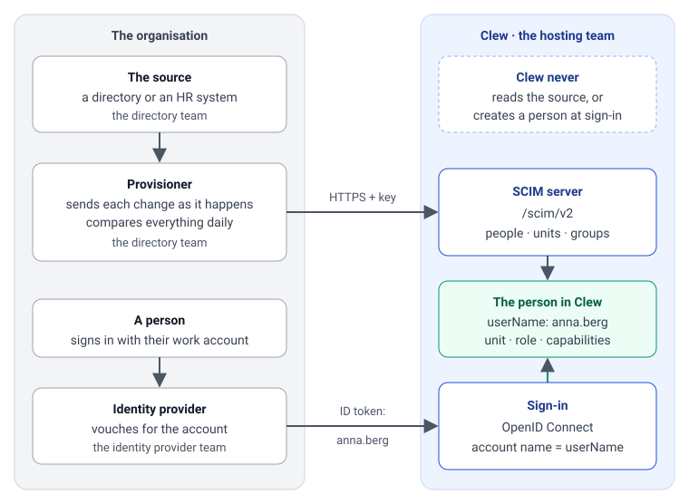

# SCIM sign-in and hosting

Clew never reads an organisation's directory. People, units and groups are sent to Clew by a **provisioner**, a process the installation runs itself, using SCIM 2.0 with Clew’s unit extension and group-key conventions. A person who has not been sent cannot sign in, and a person who has been sent signs in through the organisation's own identity provider.

The **source** is the directory, HR system or metadata catalogue that holds the people and the organisation. The **provisioner** reads the source and sends changes to Clew. Administration › Användare lists it as a *katalog* under "Inläsning från katalogen". It authenticates with a bearer **token**, called *nyckel* on that page. A **group key** is the group's complete SCIM `externalId`. For example, in `unit:110`, the prefix `unit:` identifies a unit and `110` identifies which one.



*Figure 1. At first sign-in, Clew links the account to the active person whose `userName` matches the configured claim, provided that person is free to bind under the issuer. Later sign-ins use the stored issuer and subject (`iss` and `sub`). A claim naming a different person causes Clew to refuse the sign-in.*

## Who delivers what

| Team | Delivers | Section |
|---|---|---|
| The directory team | A provisioner: a process that sends each change in the source to Clew when it happens, and compares the whole source with Clew at least once a day | [The directory team](scim-directory-operations.md#the-directory-team-a-provisioner) |
| The identity provider team | A client for Clew that is never replaced, the claim that carries the account name, a sign-out that reaches Clew, and accounts that are disabled, not deleted, when a person leaves | [The identity provider team](#the-identity-provider-team-sign-in) |
| The hosting team | A public address over HTTPS, a proxy that lets a request through, PostgreSQL and the master key, a place for the token, the first token, a test installation, and an operator for Clew's scripts | [The hosting team](#the-hosting-team-address-token-and-environments) |
| Clew's administrator | The provisioner's token, replaced or taken back on Administration › Användare, and the check's token, taken back after each check | [The hosting team](#the-hosting-team-address-token-and-environments) |

## The identity provider team: sign-in

Clew signs people in with OpenID Connect and creates nobody at sign-in. The identity provider vouches for the account; the provisioner has already said who the person is.

| What | Value |
|---|---|
| Client | Confidential (with a client secret), Authorization Code with PKCE (`S256`) |
| Scopes | `openid profile email`. Clew requires a refresh token. For direct Microsoft Entra v2, configure `OIDC_REQUEST_OFFLINE_ACCESS=true` in Clew to also request `offline_access`. Agree consent with the IdP team. |
| Redirect address | `<Clew's public address>/api/auth/callback` |
| Address after sign-out | `<Clew's public address>/login` |
| Back-channel logout, for a provider that has it, such as Keycloak | `<Clew's public address>/api/auth/backchannel-logout` (OpenID Connect Back-Channel Logout, RS256) |
| Front-channel logout, for Microsoft Entra ID, which has no back-channel logout | `<Clew's public address>/api/auth/frontchannel-logout`, entered as the app registration's front-channel logout URL. Add the optional claim `sid` to the ID token: without it, Clew's sessions carry no `sid`, and a sign-out at Entra cannot name them. |
| Issuer | Over HTTPS, with its discovery document reachable from Clew's server |

### The claim and the user name

At first sign-in, Clew compares the configured ID token claim (`preferred_username` by default) only with the provisioned `userName`. A `userName` can be an e-mail address. The comparison ignores case and uses one Unicode form, so `Åsa`, `åsa` and an `å` written as two characters match. The account binds to the active person with that `userName` if they have no binding under the issuer. Later sign-ins use the stored issuer and subject (`iss` and `sub`). A claim naming a different person causes a refusal. If the claim is absent or names nobody, the existing binding still identifies the person. Access requires the person to be active and have a unit assignment.

Anna's ID token, the part Clew reads at her first sign-in:

```json
{
  "iss": "https://login.example.org/realms/organisation",
  "sub": "7c0d1c1e-5a4b-4f0e-9d53-0b9a4c6f2a11",
  "preferred_username": "anna.berg"
}
```

| The claim holds | The provisioner sent `userName` | The sign-in |
|---|---|---|
| `anna.berg` | `anna.berg` | Anna is signed in |
| `Anna.Berg` | `anna.berg` | Anna is signed in: case does not matter |
| `anna.berg@example.org` | `anna.berg` | Refused at first sign-in because the `userName` differs |
| `anna.berg@example.org` | `anna.berg@example.org` | Matches Anna at first sign-in if she is active and free to bind under the issuer |
| `anna.berg` | nobody has it | Refused: the person has not been sent |
| `anna.berg`, from a new account with another `sub` | `anna.berg`, already bound to her first account | Refused: an account that is replaced is not bound again by itself, only by [Clew's operator](#moving-a-sign-in-to-another-account) |
| `omar.ali`, from Anna's account | `anna.berg` for Anna and `omar.ali` for Omar | Refused: the account is bound to Anna, and the claim names Omar |

With some identity providers the claim holds the whole sign-in address, `anna.berg@example.org`, and not the short account name. Either the provisioner sends that same value as `userName`, or the installation names another claim that holds the short name. Decide which with the directory team before the first person is sent. Changing `OIDC_BINDING_CLAIM` after people have signed in keeps their bindings, but the new claim is the one compared at every sign-in: a person whose value under it is another person's account name is refused. Administration shows whether a binding exists. Verify usable access with a signed-in request and check the person's active state and unit assignment. Why a sign-in was refused is in [When a sign-in is refused](#when-a-sign-in-is-refused).

For direct Entra integrations, verify the [Microsoft refresh-token scope requirement](https://learn.microsoft.com/en-us/entra/identity-platform/scopes-oidc#the-offline_access-scope) with the IdP team.

#### Handing an account name to another person

1. The identity provider team confirms that the former account can no longer sign in to Clew with the name being reassigned. For a leaver, confirm the account is disabled. For someone still employed, first change their claim to a name that is free in both systems. Keep the name being reassigned off the new account until step 3.
2. The directory team moves the `userName` off the former person's row if it is still there. For someone still employed, set it to the name agreed in step 1. Assign the freed name to the intended person's row. Look up the intended person by their stable `externalId` and confirm their SCIM `id` and resulting `userName`.
3. The identity provider team sets the new holder's claim to the confirmed name. Check that each active account now presents the name on its own Clew person.

For a swap, use an unused temporary name on both systems to free the first name. If the teams cannot coordinate the individual steps, pause sign-ins to Clew for both affected accounts. Let any sign-ins already using the old claims finish or expire before applying the changes. Resume sign-ins once each active account's claim matches its own Clew person.

### Keep each account's subject

Clew knows an account by its subject (`sub`) from the first sign-in on. Every account's subject must stay the same under the configured issuer for as long as the installation lives.

- **Disable a leaver's account; do not delete it.** "Close the account" on these pages means disable it. Keep it disabled for as long as the person may come back, and delete it only under the organisation's retention decision ([D123](../decisions/D123-clew-empties-expired-sign-in-data-itself-and-a-leavers-retention-is-the-organisations-decision.md)). A returner then signs in with the same account once the provisioner has made them active again.
- **Never make an account again for the same person.** An account that is deleted and made again has a new subject, and Clew refuses it, since the person is bound to the old one. Disable and enable the same account instead.
- **Never replace Clew's client.** In Microsoft Entra ID the subject differs for every app registration, so a new registration gives every account a new subject and refuses everybody who has signed in before. Keep the registration for the installation's whole life: rotate its secret, never replace it. A rotated secret ends no session in Clew; Clew's requests to connected systems that act as the person wait until the hosting team has set the new secret.
- **Keep the accounts' ids in a migration.** A move that keeps the issuer but not the accounts' ids, such as a realm imported again without its user ids, gives every account a new subject too.

A new issuer is another matter. Bindings are kept per issuer, so after a change of `OIDC_ISSUER` every open session ends and everybody is bound again by the claim at their next sign-in. If a change that gives the accounts new subjects under the same issuer cannot be avoided, tell Clew's operator before anybody signs in again: each person who has signed in before is then moved one at a time ([Moving a sign-in](#moving-a-sign-in-to-another-account)).

### Signing in and signing out

A sign-in follows the identity provider's own session ([D121](../decisions/D121-a-sign-in-follows-the-identity-providers-session.md)). Clew sends no `prompt` and no `max_age` and does not require `auth_time`, so a person who is already signed in at the identity provider comes into Clew without typing anything. A session in Clew lasts at most eight hours. Where a fresh sign-in is needed, the identity provider asks for it: in Microsoft Entra ID, a Conditional Access policy for Clew's app registration with the sign-in frequency "Every time", for example on shared computers; in Keycloak, the realm's authentication flow and session settings.

"Logga ut" in Clew ends Clew's session, with a `logout` row in `auth_audit`, and sends the browser to the identity provider's sign-out page. Keycloak asks the person to confirm, and Entra asks which account to sign out; the provider's own session ends only if the person does. A person who leaves that page without doing so leaves the provider's session open, and on a shared computer the next person who chooses "Logga in" in the same browser comes into the previous person's account, unless the provider's policy asks for a sign-in.

Signing out at the identity provider ends the person's sessions in Clew: through back-channel logout with Keycloak, and through front-channel logout with Entra. Each session that ends is a `backchannel-logout` or a `frontchannel-logout` row in `auth_audit`. The front-channel address is loaded by the person's browser, in a frame of the provider's sign-out page, not by the provider's server, so the proxy must let a `GET` of it through from every browser; it needs no cookie. A front-channel request ends the sessions that carry its `sid`, and one without an `iss` is taken as the configured issuer's. One that gives another `iss`, or an empty one, ends nothing and is answered 400; one without `sid` ends nothing and is answered 200. Front-channel logout depends on the browser: one that is closed before the provider's page loads the address, or that blocks the frame, leaves Clew's session open until a renewal is refused or the session ends.

While a person works, Clew renews the identity provider's tokens with the person's requests, at least every five minutes. When the provider refuses because only a new sign-in would help (`invalid_grant`, `interaction_required`, `login_required` or `consent_required`, which a Conditional Access policy can cause), the session ends with `refresh-failed` in `auth_audit`, and the person signs in again. A renewal whose ID token names another subject ends it the same way, and so do tokens that the master key can no longer open. Any other failure keeps the session: an unreachable provider, a wrong client secret, a time-out. Clew's own pages go on working, and Clew answers a request to a connected system that acts as the person with "Tjänsten går inte att nå just nu." until a renewal succeeds. The server log then has a `warn` line with the scope `auth`, "token refresh failed; sessions are kept and delegation waits", at most once a minute in each server process.

### When a sign-in is refused

A person who is refused comes back to Clew's sign-in page with one line. "Kontot saknar behörighet till Startsidan." means that Clew refused the person, and Clew's database says why: the authentication log (`auth_audit`) and the audit table (`audit`).

| What happened | In `auth_audit` | In `audit` | What to do |
|---|---|---|---|
| A first sign-in, and the claim names one active person | `identity-bound` on `person:<id>` | `identity.bound`, with the issuer and the claim's name | Nothing: the person is bound |
| At a first sign-in, the claim names nobody, or a person who has left | `identity-unmatched`, with the actor `claim:<value>`; then `login-denied`, which names the person who has left when the claim named one | Nothing | Check that the provisioner sent the person as active, and that the claim and the `userName` hold the same value |
| The person is bound, but has left or has no `unit:` or `unit-manager:` membership | `login-denied` naming the person, at every sign-in | Nothing | Nothing for a person who has left; otherwise the provisioner places the person |
| The account has a new subject: it was deleted and made again, or Clew has a new app registration | `identity-conflict` on the person, then `login-denied` naming them | `identity.conflict` on the person, with the claim's value, the refused `subject` and no `holder` | [Move the sign-in](#moving-a-sign-in-to-another-account) |
| The subject is bound to one person, and the claim names another | `identity-conflict` on the person the claim names, then `login-denied` naming the person who holds the subject | `identity.conflict` on the person the claim names, with the claim's value, the refused `subject` and the `holder` | [Move the sign-in](#moving-a-sign-in-to-another-account), once the account names agree |
| The ID token carries no claim at a first sign-in | `login-denied` with no person | Nothing | Have the identity provider put the claim in the ID token |

"Inloggningstjänsten går inte att nå just nu." and "Inloggningen kunde inte slutföras. Försök igen." mean that the sign-in failed before Clew could decide about the person. Each sign-in that fails at its start or at the callback, a refused person included, and each refused back-channel or front-channel logout, is one line with the scope `auth` in the server log: "sign-in could not start" at the level `error`, or "sign-in failed at the callback", "back-channel logout refused" or "front-channel logout refused" at the level `warn`. A refused "Logga ut", answered "Utloggningen kunde inte bekräftas. Försök igen.", writes no line. Its field `failure` holds `name`, and where they exist `code`, `oauthError`, `status`, `message` and `cause`. The line never holds a claim, the provider's `error_description`, a token or a value a database statement was given.

| In `failure` | It means |
|---|---|
| `oauthError` `invalid_client`, `status` 401 | The client secret is wrong |
| `code` `OAUTH_JWT_CLAIM_COMPARISON_FAILED`, with a `cause` that names `aud`, `iss` or `nonce` | The client id or the issuer is wrong, or a sign-in was replayed |
| `code` `ERR_JWT_CLAIM_VALIDATION_FAILED` or `ERR_JWT_EXPIRED`, on a back-channel logout | A logout token for another client, or clocks that differ |
| `name` `TypeError`, `code` `ENOTFOUND` or `ECONNREFUSED` | Clew's server cannot reach the identity provider |
| `name` `AuthError`, `code` `denied`, `status` 403 | Clew refused the person; why is in `auth_audit` |
| `name` `AuthError`, `code` `invalid`, `status` 401 | Clew's own refusal: no sign-in under way in this browser, or one older than five minutes, an answer without a refresh token or an ID token, or a logout from another issuer |
| `name` `DrizzleQueryError` or `PostgresError` | The database failed. `code` is PostgreSQL's SQLSTATE (`57P01` or `57P03` a failover, `57014` a statement timeout, `40P01` a deadlock, `53300` too many connections) or the connection's code (`ECONNREFUSED`, `ENOTFOUND`, `CONNECTION_CLOSED`, `CONNECT_TIMEOUT`) |

### Moving a sign-in to another account

Only Clew's operator moves a binding, with a script inside Clew's app container: never on a page, and never by itself ([D68](../decisions/D68-people-are-pushed-into-clew-through-standard-scim.md) item 6). It is needed when the source changed the id of a person who had signed in and could not re-key the row first, when an account was deleted and made again, when Clew got a new app registration or the accounts got new ids under the same issuer, and when an account name moved between two people and one of them signed in before Clew had moved it. The refusal's `identity.conflict` row in the audit table holds what the script needs: `subject`, the refused subject, and `holder`, the person who holds it, if anybody does.

- `bun scripts/identity-rebind.ts --person <person id> --subject <new subject> --operator "<your name>"` moves the person's binding to the new subject.
- `bun scripts/identity-rebind.ts --person <person id> --release --operator "<your name>"` removes the binding. The next sign-in whose claim names the person binds them again, as a first sign-in does.

Each run that changes a binding writes one `identity.rebound` row in the audit table, about the person, with the issuer, the old and the new subject, and the operator's name; a subject is `null` where there is none, as the new one is after a release. A run that changes nothing says so and writes nothing. The script refuses a subject that another person holds, writing nothing, and prints the command that releases that person. The person's sessions under the old subject end at their next request. To undo a move, run the script again with the old subject from that row.

| What happened | What the refusal shows | What the operator does |
|---|---|---|
| The source gave a person who had signed in a new id, and the example deactivated the old row O and made a new row N with the same account name | `identity-conflict` on N, `holder` O | `--person <O> --release`; the next sign-in binds N by the claim. To bind at once, follow it with `--person <N> --subject <subject>`. Better: when the source can map the old id to the new, re-key the existing row with a `PATCH` of `externalId` before the push, and nobody is refused. |
| The account was deleted and made again, or Clew has a new app registration | `identity-conflict` on the person, with the new `subject` and no `holder` | `--person <id> --subject <subject>`, or `--release`. After a new registration, one run for each person who is refused: there is no run for everybody at once, and a release needs no subject. |
| An account name moved, and the new holder T signed in while Clew still had the name on H | `identity-conflict` on T, `holder` H | Once the names agree in the identity provider and in Clew, `--person <H> --release`; each of them then binds by the claim. If H's own subject is known from H's own refused sign-in, `--person <H> --subject <it>` frees T's subject as well. |

Never change account names to make a refusal go away. While T's subject is bound to H, a claim that names nobody, or names H, lets T in as H with H's access: only a claim that names another person is refused.

### Hand over, and keep doing

- **Hand to the hosting team:** the issuer's address, the client id, the client secret, and the name of the claim when it is not `preferred_username`. A rotated client secret goes the same way.
- **Disable the account when a person leaves, and keep it disabled.** Deactivation in Clew arrives when the provisioner sends it; the identity provider is what stops a sign-in if that change is late. Delete the account only under the organisation's retention decision, never while the person may come back.
- **Keep every account's subject.** Rotate the client's secret, never replace the client, and never make an account again for the same person. If a change that gives the accounts new subjects cannot be avoided, tell Clew's operator before anybody signs in again.
- **Coordinate every reused account name with the directory team.** Withdraw the former account's claim before the name moves to another person in Clew. Give it to the new account after the intended person's SCIM row has been verified. [Account-name handover](#handing-an-account-name-to-another-person)

### Done when

- An active person with a placement opens a page that needs sign-in and retains access after the first access token expires and the session is refreshed.
- A person who is already signed in at the identity provider comes into Clew without a new prompt, unless the provider's policy asks for one.
- A person who has an account at the identity provider and has not been sent is refused.
- Signing out at the identity provider ends the session in Clew, as a `backchannel-logout` row in `auth_audit` with Keycloak and a `frontchannel-logout` row with Microsoft Entra ID.

## The hosting team: address, token and environments

| What | Value |
|---|---|
| Public address | `PUBLIC_URL`, over HTTPS, with no path. The SCIM server answers at `<public address>/scim/v2`. |
| Listening address | `HOST`. The server listens on loopback (`127.0.0.1`) unless `HOST` says otherwise; behind a proxy in another container it is `0.0.0.0`. `PORT` is 3000 unless set. |
| Reachable from | Wherever the provisioner runs. Nobody else needs `/scim/v2`; it may be closed to every other network. Every person's browser needs the rest of the address, `/api/` included: the sign-in returns there, and Entra's sign-out loads the front-channel logout address there. Keycloak's servers need `/api/auth/backchannel-logout`. |
| Database | PostgreSQL, named by `DATABASE_URL`. Run `bun run db:init` before the first start and after each upgrade: it applies Clew's migrations and the schema of the engine that runs Clew's durable work. |
| Instance and release | `CLEW_EXECUTOR_ID`: a name for each server process that it keeps across restarts and deployments, such as `clew-1`. Unset, it is the host name, which changes whenever a container is made again. `CLEW_RELEASE`: a new name for each release. The durable engine marks every piece of waiting work with the release that started it and resumes it only in a process of that release ([D85](../decisions/D85-dbos-transact-replaces-temporal-as-the-durable-engine.md)), so each deployment ends with a step, below the example. |
| Master key | `MASTER_KEY`: 32 random bytes in base64, made once with `openssl rand -base64 32`. Keep it in the secret store and back it up with the database. Never make a new one on a redeploy. At its first start Clew seals its own signing key for connected systems with this key. Under another key Clew cannot open that signing key, so it does not start at all. A new key also cannot open the secrets and sessions sealed with the old one, and changes every stored authorization value at once ([runbook](../maintainers/reliability-operations.md#changing-the-authorization-fingerprint)). |
| Request size | Let 4 MB through. Clew refuses a larger body itself. The largest request is a unit group with all its members. |
| Request time | Measure how long it takes to write your largest group in the test installation. Set the proxy timeout above that duration, with room for slower writes. |
| While Clew starts | It answers 503 with `Retry-After`. A provisioner waits and tries again. `GET /api/ready` answers 200 once Clew has started and its database answers within a second, and 503 until then; `GET /api/health` answers 200 whenever the process runs. |
| Sign-in settings | `OIDC_ISSUER`, `OIDC_CLIENT_ID`, `OIDC_CLIENT_SECRET`, `OIDC_REQUEST_OFFLINE_ACCESS` when required and, when the claim is not `preferred_username`, `OIDC_BINDING_CLAIM`, from the identity provider team |

The settings for the example, as Clew's server reads them from its environment:

```bash
export PUBLIC_URL=https://clew.example.org
export HOST=0.0.0.0
export CLEW_EXECUTOR_ID=clew-1     # clew-2 for the second process, and so on
export CLEW_RELEASE=2026.11.13     # a new name for each release
: "${DATABASE_URL:?Supply the database address through the secret store}"
: "${MASTER_KEY:?Supply the master key through the secret store}"
export DATABASE_URL MASTER_KEY
export OIDC_ISSUER=https://login.example.org/realms/organisation
export OIDC_CLIENT_ID=clew
: "${OIDC_CLIENT_SECRET:?Supply the client secret through the secret store}"
export OIDC_CLIENT_SECRET
export OIDC_BINDING_CLAIM=preferred_username
```

A reverse proxy in front of Clew, here nginx, that lets a request through. Clew's server answers `/scim/v2/` and `/api/`; every other path is the web app's files, and a path that is not a file is answered with `index.html`:

```nginx
location /scim/v2/ {
    client_max_body_size 4m;
    proxy_read_timeout   60s;
    proxy_pass           http://clew-app:3000;
}
location /api/ {
    proxy_pass           http://clew-app:3000;
}
location / {
    root                 /srv/clew/web;
    try_files            $uri /index.html;
}
```

There is no recipe for running Clew in production yet: the repository's compose stack is the development one, and there is no image of the server. Today an installation is built from a checkout of the repository, with Node 26.13.0 and Bun 1.4.4 as the development container has them (`.devcontainer/Dockerfile`). Install with `bun install --frozen-lockfile`, bring the database up to date with `bun run db:init`, and start the server with `bun run --cwd apps/server start`. Build the web app with `bun run build` and serve the files in `apps/web/dist` from the same public address, as `/srv/clew/web` above. Once the processes of the older release have stopped, move the work that still waits under it with `bun scripts/workflows-move.ts`, as the operations runbook says [after every deployment](../maintainers/reliability-operations.md#after-every-deployment): a reminder, an approved action, a watch, a follow-up or a scheduled job, such as the end of an undo window, that a process of the older release had taken does not run until it is moved, and nothing logs it. The nightly scan and the nightly clean-up need no step: a server that starts takes over their last and next nights, and a night whose time fell during the deployment runs once it has. Only a deployment that took more than a day leaves an older night for the script. Say what was missing.

- **The first token comes from a script.** Nobody is an administrator until a provisioner has sent the group that makes somebody one, so the first token of an installation is issued by running a script inside Clew's app container. The organisation is an id you choose once, such as `example`, and it cannot be changed afterwards: a second token issued with the id misspelt belongs to another, empty organisation. The provisioner's id is 2 to 64 lower-case letters, digits and dashes, beginning with a letter or a digit.

  ```bash
  bun scripts/provisioner-token.ts add directory --organisation example --label "The directory"
  ```

  ```text
  Provisioner 'directory' may push to /scim/v2 for organisation 'example'. Its token, shown once:
  <the token>
  ```

  Clew keeps only the token's digest. Hand the token to the directory team through the secret store, not in a message.
- **After that, on the page.** An administrator with `admin.users` adds a provisioner ("Lägg till katalog"), replaces its token ("Byt nyckel") and takes it back ("Återkalla nyckeln") on Administration › Användare. A replaced token may go on answering for a day or a week, so the provisioner is switched without a request failing.
- **A test installation first.** Give the directory team an installation to send to before the real one, and a token under an id of its own for the check, so the check has its own last-seen time. There is one kind of token, so the check's token can write as much as the provisioner's: it can create, change and deactivate people and groups in the organisation. Issue it right before the check runs, and take it back afterwards, with "Återkalla nyckeln" on Administration › Användare or `bun scripts/provisioner-token.ts revoke check`. Until it is taken back, its row there shows "Tyst i över två dygn" two days after the check last ran.

  ```bash
  bun scripts/provisioner-token.ts add check --organisation example --label "The check"
  ```

- **The nightly clean-up runs by itself.** Every night at 03:00 Stockholm time, Clew's server deletes the sessions past either of their two expiries, with their sealed tokens, and the expired records that a sign-in under way and a back-channel logout leave behind. A session that was still open when it expired gets an `expired` row in `auth_audit`. It runs inside the server on its durable engine, once a night however many server processes there are: there is no cron job and no setting of its own. Each night schedules the next, and a server that starts schedules the next night too, and takes the last and the next night over when a deployment left them waiting under the release it replaced, so a deployment needs no step for it, and a night whose time fell during the deployment runs late. A session cannot be used once it has expired, but its row stays until the next clean-up. The authentication log itself is never deleted: how long sign-in history is kept is the organisation's decision ([D123](../decisions/D123-clew-empties-expired-sign-in-data-itself-and-a-leavers-retention-is-the-organisations-decision.md)). A night whose clean-up fails writes one `error` line with the scope `scheduler`, "sign-in clean-up failed", and the next night tries again: alarm on that line. A night that did not run at all writes no such line: by 04:00 the `audit` table has no `job.completed` row for `job:sign-in-cleanup:<date>` ([runbook](../maintainers/reliability-operations.md#sign-in)).
- **Two scripts for one person, run by Clew's operator inside the app container.** `scripts/identity-rebind.ts` moves a person's sign-in to another account ([Moving a sign-in](#moving-a-sign-in-to-another-account)). `scripts/person-erase.ts`, after the other erase scripts, erases a person who has left, when the organisation decides that their record goes ([A person pushed by mistake](scim-directory-operations.md#a-person-pushed-by-mistake)).
- **What to watch.** An unexpected failure of a request is one `error` line with the scope `scim` in the server log. What a request changed is in the audit table ([operations runbook](../maintainers/reliability-operations.md#provisioning)). A start that fails is an `error` line with the scope `startup`, "startup initialization failed; retrying in five seconds", every five seconds until the cause is put right: a database that does not answer, a schema that `bun run db:init` has not brought up to date, or a `MASTER_KEY` that is missing, is not 32 bytes, or is not the key Clew first started with on this database (bring that key back from the secret store). Until then every SCIM request, the first push included, answers 503 with `Retry-After: 5`, and Clew's own interface answers "Tjänsten startar. Försök igen om en stund." A sign-in that fails is a line with the scope `auth` ([When a sign-in is refused](#when-a-sign-in-is-refused)).
