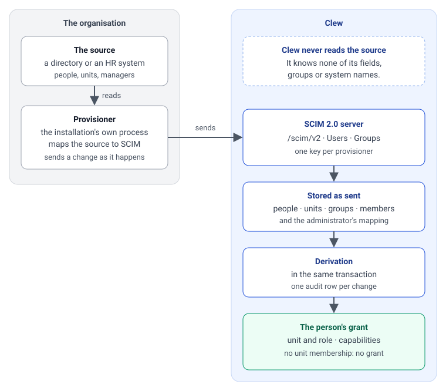
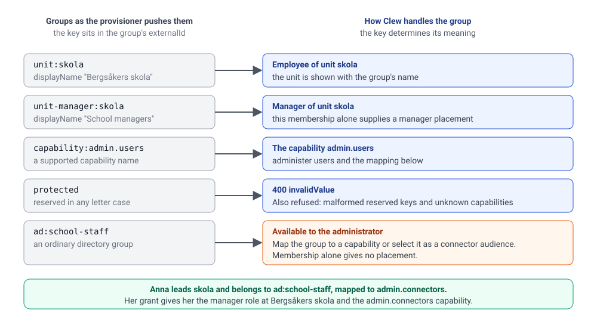

# Writing a provisioner

A **provisioner** is the one thing that puts people, units and groups into a Clew installation ([D68](../decisions/D68-people-are-pushed-into-clew-through-standard-scim.md)). It is a process the installation runs, reads the organisation's own source (a directory, an HR export, a metadata catalogue) and pushes to Clew's SCIM 2.0 server at `/scim/v2`. Clew never reads the source and never learns its name; everything the source knows about fields, groups and roles is mapped inside the provisioner. A provisioner is not a connector ([D22](../decisions/D22-connectors-not-modules.md)): it calls Clew, offers no capabilities and is reached by nobody.

This page is the protocol, for whoever writes the provisioner. What the teams around it deliver (the directory, the identity provider, hosting) and how to tell that it works is [Provisioning: what operations deliver](provisioning-for-operations.md).

The repository ships one: `scripts/provisioner/`, which pushes the development stack's directory. Read it alongside this page; it is about two hundred lines.



*Figure 1: A provisioner reads the organisation's source and sends it to Clew's SCIM server; Clew stores what was sent and derives each person's grant in the same transaction. A person who leaves the source is deactivated, never erased: audit rows and threads still point at them.*

## What Clew expects

**Users** (`/scim/v2/Users`, RFC 7643 core schema). Four attributes are required beyond the standard's `userName`, and Clew names the missing one in the error:

| Attribute | Meaning in Clew |
|---|---|
| `externalId` | The source's stable id for the person, never reused. Clew finds the person by it on later pushes. |
| `userName` | What a login is matched on. Unique across the installation and matched without regard to case, the standard's default for `userName`; a login carries no organisation. |
| `displayName` (or `name.formatted`) | The name shown in the product. |
| `emails` | Send an approved work address. Clew takes the address with `type: "work"`, otherwise an address **without a type**, the primary before the first. An address of any other type (`home`, `other`) is never taken, and a user with such addresses alone is refused with a 400 that says so. |
| `active` | `false` deactivates. `DELETE` also deactivates, because audit rows and threads reference the person; nothing is erased. A `PUT` without `active` re-enables, since the source is the authority. |

Extension schemas and unknown attributes are accepted and ignored, as the standard asks, in a `PATCH` too: adding, replacing or removing an attribute Clew does not hold (`title`, a phone number, the enterprise extension's `manager`) changes nothing and is not an error. Removing one of the five above is refused with `mutability`. A path-less `PATCH` may repeat the resource's own `id`, `schemas` and `meta`, as Okta does; an `id` that names another resource is refused.

Clew holds one name per person. Send `displayName` (or `name.formatted`) when a name changes: `name.givenName` and `name.familyName` build the name when a person is created without a display name, and do not change it afterwards.

**Deactivation, not deletion.** `DELETE /Users/<id>` deactivates, and the resource stays readable with `active: false`, where the standard expects a 404 afterwards. Three consequences follow. A client that deletes and then posts the same `userName` gets 409 `uniqueness`, so find the person by filter first and `PUT` or `PATCH`, as `push.ts` does. A deactivated person keeps the `userName` until a `PATCH` changes it, so a recycled account name has to be moved off the old row before a new person can take it. And a `PUT` of a deactivated person without `active: false` re-enables them: a provisioner that pushes everyone present undoes an administrator's `DELETE` on the next run, which is D68's intent, and the audit row says `scim.user.reactivated`.



*Figure 2: What a group means is carried by a key in its `externalId`: a unit, a manager's role or a capability. Any other group means nothing until an administrator maps it.*

**Groups** (`/scim/v2/Groups`). Every group is stored as pushed. Meaning is carried by a key in the group's `externalId`:

| `externalId` | A member gets | `displayName` |
|---|---|---|
| `unit:<unitId>` | An assignment to that unit as `employee`. The group is also the unit itself: a node of the organisation tree, which may name the unit above it (see below) | The unit's name, shown in the product |
| `unit-manager:<unitId>` | An assignment to that unit as `manager`, which wins over `unit:` for the same unit | Free |
| `capability:<name>` | That capability, one of the closed list (`admin.connectors`, `admin.users`, `admin.appearance`, `admin.competence`) | Free |
| `protected`, in any case | Refused with 400 `invalidValue` ([D93](../decisions/D93-the-protected-key-is-refused-at-the-scim-boundary.md)): Clew has not decided whether it may hold that fact, so do not send it | Free |
| Anything else | Nothing by itself; an administrator may map it to a capability in Clew ([D85](../decisions/D85-capabilities-are-mapped-from-provisioned-groups-in-clew.md)) and use it as a connector audience | Free |

A person with no `unit:` or `unit-manager:` membership exists but can do nothing, so a mapping mistake fails closed. Several memberships give several assignments; until a person can switch, the active one is a managed unit before an employed one, then the lowest unit id.

**Keys are exact, and one written wrong is refused** ([D96](../decisions/D96-a-key-written-wrong-is-refused-at-the-scim-boundary.md)). The prefixes are lower case with the id or name directly after the colon. `Unit:skola`, `unit:` with nothing after it, `unit: skola` and `capability:` with a name outside the list answer 400 `invalidValue` with the key and the reason in `detail`, instead of becoming a plain group that gives nobody anything.

**Units form a tree, and you push it** ([D99](../decisions/D99-units-form-a-tree-pushed-over-scim-and-a-manager-works-with-their-direct-reports.md)). An organisation is a tree, and Clew holds it as you send it: every unit is a `unit:` group, also a unit nobody is placed on (a heading such as "Avdelningar"), and a unit below another names the one above it in an extension schema on the group:

```json
{
  "schemas": ["urn:ietf:params:scim:schemas:core:2.0:Group", "urn:clew:params:scim:schemas:extension:unit:2.0:Group"],
  "externalId": "unit:9540",
  "displayName": "Utveckling",
  "members": [{ "value": "<the person's SCIM id>" }],
  "urn:clew:params:scim:schemas:extension:unit:2.0:Group": { "parent": "unit:11213" }
}
```

`parent` is the `externalId` of the unit group above, written as exactly as a key is. A root carries no extension, and an installation may have several roots (a municipality and each of its companies). Clew holds an id, a name and a parent for a unit and nothing else: no levels and no kinds, so a förvaltning, an avdelning and an enhet are all units, and the depth may differ from branch to branch. Clew never works the tree out from the people: a tree that exists only as a path on each person has to be turned into units in the provisioner, and it is better still when the source can list its units with a parent id.

- **Push from the root down, remove from the leaves up.** A parent that does not exist yet answers 400 `invalidValue`, and so does a parent in another organisation, a unit as its own parent, a parent that stands below the unit (a cycle), and the extension on a group that is not a `unit:` group. `DELETE` of a unit that still has units below it answers 409 and names them.
- **A move is a change of `parent`.** `PUT` the unit group with the new parent, or `PATCH` the path `urn:clew:params:scim:schemas:extension:unit:2.0:Group:parent` (`replace` to move, `remove` to make a root); a `PUT` without the extension also makes a root, and a unit group whose key stops being a `unit:` key (a `PATCH` that replaces or removes `externalId`) loses its parent with it. Name the extension by its URN in `attributes` or `excludedAttributes` to read or leave out the parent. Keep the unit's id through a reorganisation: everything in Clew that names the unit follows it, and remember that a new parent can change which managers see a branch’s people.
- **Place a person once.** A person is a member of the `unit:` group of the unit they work in, and of `unit-manager:<id>` for a unit they lead. Do not put a manager into the manager group of every unit below their own.
- **The reporting line follows the tree.** A person reports to the managers of the nearest unit, their own or above it, that has a manager; a manager reports to the managers of the nearest unit above their own that has one; a unit nobody leads passes the line through, and so does a unit whose only managers are deactivated. In the product a manager sees and works with their reports: the people placed with them and the managers directly below, never everyone in the branch. So a manager high up needs the managers below them to be pushed as managers of their own units, and a person on a unit with no manager on it or anywhere above it reports to nobody: the check names such a unit.

**A group's members are people.** A group as a member of a group is refused with 400 `invalidValue`; send the people. The tree is the `parent` above, not nesting.

**Transport.** `filter` supports one equality: `userName eq "…"` or `externalId eq "…"` on users, `externalId eq "…"` or `displayName eq "…"` on groups. `startIndex` and `count` page, at most 200 rows. `attributes` and `excludedAttributes` narrow what a read answers, in the address or in a `.search` body; `excludedAttributes=members` reads a large group without its members. `PATCH` takes a path per operation (`members`, `members[value eq "<id>"]`, `active`, `userName`, …), the schema-qualified form and the path-less object form that Microsoft Entra and Okta send. Bulk, sorting and ETags are not offered; `ServiceProviderConfig` says so. Errors are the standard's error resource with `scimType` and an English `detail`. While the server starts it answers 503 with `Retry-After`.

**Concurrent writes.** User PUT, PATCH and DELETE lock the person's row before reading current fields. Group writes lock their group, and grant derivation serialises changes for each person. Independent patches preserve each other's attributes. Two changes to the same attribute take effect in commit order. The writer must order its source events and snapshot replay.

**Authentication.** A bearer token issued to the provisioner by a Clew administrator, for this purpose alone. An administrator with `admin.users` issues it on Administration › Användare ("Lägg till katalog"), where it is shown once, and replaces it or takes it back there ([D107](../decisions/D107-an-administrator-issues-replaces-and-takes-back-a-provisioners-key-on-the-users-page.md)). The first token of an installation, before anybody is an administrator, comes from the script:

```bash
docker exec -w /workspace clew-app-1 bun scripts/provisioner-token.ts add metakatalogen --organisation sundsvall --label "Metakatalogen"
```

The token is printed once; Clew keeps its digest. `rotate <id>` issues a new one and lets the old one answer for a grace period (24 hours unless `--grace-hours` says otherwise), so the provisioner is switched without a push failing (Clew keeps one old token: rotating again inside the grace period ends the one before, and the script says so); `revoke <id>` ends every token of the provisioner at once; `list` shows each provisioner with its state and when it was last seen. The token scopes users and groups to the organisation it was issued for: another organisation's resources do not exist for this client, while `userName` and `externalId` stay unique across the installation. A unit belongs to the organisation that pushed it: `unit:<id>` or `unit-manager:<id>` for a unit another organisation holds is refused with 400 `invalidValue` (D101).

Clew records when a provisioner last called, and Administration › Användare shows it with a warning after two days of silence. A push that changes nothing still leaves that mark and one `provisioner.seen` audit row, so "it ran and nothing changed" and "it has stopped" look different.

## What a provisioner does when something changes

A change in the source is sent to Clew when it happens, not saved for a nightly run ([D109](../decisions/D109-a-provisioner-sends-a-change-when-it-happens-and-reconciles-the-whole-source-daily.md)). A profile update takes one request. Creating and placing a person or moving them between units takes two. More complex duty changes can require several requests. Each committed change takes effect at the next access check.

| In the source | Send |
|---|---|
| A person begins | `POST /Users`, then `PATCH` `add` on the `unit:` group they are placed on |
| A name, a user name or a work address changes | `PATCH /Users/<id>` |
| A person leaves | `PATCH /Users/<id>` with `active` `false` |
| A person moves to another unit | `PATCH` `add` on the unit they join, then `PATCH` `remove` on the unit they leave |
| A person becomes a manager, or stops being one | `PATCH` `add` or `remove` on `unit-manager:<id>` |
| A person gains or loses a capability | `PATCH` `add` or `remove` on the capability's group |
| A unit is added | `POST /Groups` with its `parent`, once the unit above exists |
| A unit is renamed or moved | `PATCH` its `displayName` or its `parent` |
| A unit is removed | `DELETE /Groups/<id>`, once nothing stands below it and its people have been placed elsewhere |

A unit, a manager's role and a capability are memberships, and SCIM changes a membership on the group, not on the person: a user's `groups` are read only. A source that holds the unit and the manager flag as fields on the person turns a change of such a field into the group requests above. A change that takes effect on a day (an acting manager from the first of the month) is sent on that day: Clew holds no dates of validity.

## What a provisioner does on every reconciliation

Beside the changes, the whole source is compared with what Clew holds at least once a day. A change that was lost on the way, because the provisioner was down or a request failed and was not sent again, is found by nothing else, and the run leaves an unchanged person’s fields, memberships and grant intact. It still sends a full replacement for each present person.

The organisation first, then the people, then who is placed where ([D101](../decisions/D101-a-provisioner-pushes-the-organisation-first-and-adds-before-it-removes-and-a-unit-belongs-to-one-organisation.md)). Read the organisation from the source as a list of its own: each unit with its id, its name and the id of the unit above it.

1. Read the people Clew holds (`GET /Users`, a page at a time) and compare with the source. Stop here when the run would deactivate far too many (see the guard below).
2. The units, from the root down: `GET /Groups?filter=externalId eq "unit:<id>"`, then `POST` the unit when it is absent, with its name and its `parent` and no members, or `PATCH` its `displayName` or its `parent` when one of them changed. The unit above then exists when the one below is written. Do not `PUT` a unit without its members: that empties it.
3. For each person in the source, send an explicit active state. Keep a returning person inactive through group cleanup and enable them afterwards. Use `POST` when absent or `PUT` when present. Do not create a person the source keeps as inactive and Clew has never held: a disabled row holds their `userName` against the next person who is given it. The server writes nothing when nothing changed. For each person Clew knows under this provisioner's `externalId` space who is no longer in the source: `PATCH` `active` to `false`.
4. Who is in which group (the units, the managers of each unit, the capability holders, the plain directory groups), as SCIM ids from step 3, **in two rounds**. First, for every group, `PATCH` `add` the members it gains (or `POST` a group that does not exist with its members). Then, for every group, `PATCH` `remove` the members it loses. A person who moves between two units is then in both for a moment and never in neither. Sent the other way round, the person has no unit between the two writes, Clew takes their access away and hands it back, and a request in between signs them out.
5. For each group with a key this provisioner owns that no longer follows from the source: `DELETE`, a unit only once no unit that is also going still stands below it. Groups with other keys belong to somebody else and are left alone.

Run it at least daily, as the net under the changes sent as they happen. Validity lives in the source (a ställföreträdare is a membership the provisioner adds when the period starts and removes when it ends), so access ends when the change arrives. A leaver's account must also be closed at the identity provider.

**Guard the complete export.** Only mark `Directory.complete` after checking all pages or source manifest counts for people, units, groups and memberships. An incomplete export is refused before any write, including with `force`. The example checks four populations: owned active users (absent or now inactive), units, plain groups, and manager and capability groups together. It stops when a run would withdraw all of one of them, which is what an empty export looks like, or more than one row and more than 20% of it. One row is always let through, so a source of three people can lose one of them. An operator can approve a verified large change. Give each writer a stable user prefix and disjoint group prefixes or exact keys, including for administrative groups. The token scopes the organisation and does not partition writers within it.

**A user name is not free again by itself.** `DELETE` deactivates and erases nothing, so a leaver keeps their `userName` and a new person with the same one is refused with 409. A source that reuses user names gives the leaver another `userName` first (a `PATCH` of `userName` on the deactivated person).

## Checking a push

Export `CLEW_PROVISIONER_TOKEN` from the secret store before running the checker.
```bash
bun scripts/provisioner-check.ts https://clew.example/scim/v2
bun scripts/provisioner-check.ts https://clew.example/scim/v2 --roots 1
```

`--roots <n>` says how many roots the source's tree has; the check warns when the count differs in either direction. Compare exact parent links separately.

The check reads what the installation holds, over SCIM alone, and changes nothing: that the endpoint and the token answer, how many users and groups of each kind there are, which active users have no unit (and so no access), which managed units no `unit:` group names, how many roots and levels the tree has, which unit groups are empty (a unit with units below it may be a heading and is not named), which units have people and no manager on them or above them, and which stored groups carry a key written wrong. An administrator sees the same tree in the product, on Administration › Organisation. It authenticates as the provisioner, so it counts as a call from it; issue the check a token under an id of its own to leave the provisioner's last-seen time alone.

## The example

`scripts/provisioner/directory.ts` is the development stack's source: two hundred and fifty people in forty-eight units that form a tree of six levels at its deepest (the municipality, its five administrations, departments under three of them, an area under a department, the units people work in, and a group under a unit), with a manager on every level, so a head of an administration has heads of departments below them who have unit managers below them; a department nobody leads, a unit led from the one above it, and two administrations whose units stand directly under them, since the depth differs between branches; each person with a unit and a manager flag, some working in or managing a second unit, one unit with two managers, everyone in plain directory groups (`ad:…`, which mean nothing in Clew until an administrator maps or names them) that run from nobody to seventy members, a few with Clew capabilities, seven written by hand with the names a generator does not come up with (a hyphen, an apostrophe, accents, a very long name, two people with one name), and three of them personas with a Keycloak account. `push.ts` maps those facts to the groups above (`plan()`, pure: the units from the root down) and pushes them in the order above (`push()`, idempotent: the organisation, the people, additions before removals, removing from the leaves up, with the guard against an empty or truncated source), through `client.ts`, the SCIM client. `bun run auth:setup` runs it in-process after creating the Keycloak accounts; `bun run dev:provision` runs it over HTTP against a running `bun run dev`. `tests/unit/provisioner.test.ts` runs it against the routes on the memory store and is the shape a provisioner's own tests can take: no network, no vendor account. Its last test is of another kind: it runs the Bash blocks of the [operations walkthrough](provisioning-for-operations.md) with `bash`, `curl` and `python3` against the same routes on a loopback port.

To write yours, supply a complete source snapshot with explicit `active` values, an approved work address and a `SourceScope` for `push`. List exact keys for shared prefixes that have different owners. The example removes expired duties before re-enabling a returning person. Serialize snapshots with event delivery and persist the last confirmed source cursor. Log the last successful full run and the oldest outstanding change. [Operations handover](provisioning-for-operations.md) includes recovery by HTTP outcome and an executable installation check.
