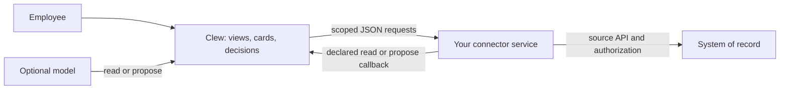

# What Clew does

An employee's day crosses calendars, HR, finance, case systems and directories. Clew brings the relevant work together: what needs attention, why it matters, what the person can do next, and what the source confirmed after an action. The public-sector product uses Swedish labels and is called Startsidan; identifiers, contracts and documentation are English.

A typical integration starts with a read: find a colleague, show outstanding items or inspect a record. A scan can later turn an occurrence in that source into a card. The person can ask about it, review a proposal and press its action. Clew records the decision and presents a receipt. The source remains responsible for its business records and authorization.

## The integration boundary

Your connector runs as its own service, in any language and deployment environment that can serve the protocol. It can implement the contract beside the source or translate an existing REST, SOAP, native or vendor MCP interface. It is registered by URL and transport secret in Clew's database. You do not add code to Clew's server or frontend for each integration.

## The vocabulary

| Term | Meaning for an integrator |
|---|---|
| Connector | One independently operated integration, with a stable id and manifest. Its `source` is the human-readable system name. |
| Capability | A named operation such as `telefonbok.directory`, with input/output JSON Schemas, a kind, scope and model visibility. |
| `read` | Returns data without changing the source. It can have a declared view and be a model tool. |
| `propose` | Prepares something for review. It must not perform the proposed source write. |
| `execute` | Performs an approved source action. Always `model: false`; reached through Clew's human decision flow. |
| Area | A grouping of standing capabilities that Clew shows to eligible people. |
| View | Semantic presentation data: table, list, detail or text. Clew owns rendering, layout and accessibility. |
| Ref | A stable source-object identifier that can be passed back to its owner. It is not authorization. |
| Scan and occurrence | A deterministic read returning card drafts and optional observation metadata. Source key, assignment and recurring period identify work; `topic` groups its presentation. |
| Receipt | Per-item source outcomes, including unresolved outcomes and an optional compensating action. |
| Actor | The person and assignment from a verified Clew assertion. Source access must still be narrowed for that actor. |

## What belongs where

**Users are core entities.** Local users and access grants are always part of Clew. The internal user-information reads share capability dispatch but do not appear under connected systems or have an on/off control. External directory/provisioning integrations remain separate ([D62](decisions/D62-users-are-core-entities-not-connected-systems.md)).

**Clew owns coordination.** It holds local identity/grants, connector governance, threads, decisions, audit and execution/follow-up state. Its core modules are part of Clew itself. A connector must not assume that storing a ref grants indefinite access to the corresponding content: reads recheck current access.

**Your source owns its records.** A `passthrough` connector reads the source and maps its responses. A `derived` connector supplies a computed result or snapshot with a defined purpose. Avoid copying source records into Clew or logging request bodies. Card text and persisted answers need deliberate data minimization; use a live view for sensitive detail and `modelReads: "summary"` where the model should receive only a count. That flag does not redact other capabilities or user-entered text.

**The model is optional.** Buttons, views and deterministic reads work without it. Model calls use the person's scope; the model cannot approve a source action. Eneo can supply an optional search connector, but Clew does not require Eneo or a hosted model service. Clew does not provide document ingestion, a cross-source query language or a process designer.

**Clew owns presentation.** Connectors send data and view declarations. They do not send component trees, HTML applications, CSS or iframes. A view that cannot be expressed by the supported catalogue should link to the source system.

## Choose the smallest useful connector

Start with reads and a view, using the [phone book](guides/example-custom-directory.md). Add `<id>.search` and `<id>.fetch` if the records should join the composite search. Add a scan when the source has an occurrence that needs the person's attention. Add executes only after defining source authorization, revision checks, receipts and recovery from an uncertain response.

The [status matrix](reference/status.md) distinguishes working paths from plans. The [vision](vision.md) describes the longer-term product; the [decision log](decisions/README.md) retains the reasoning.
