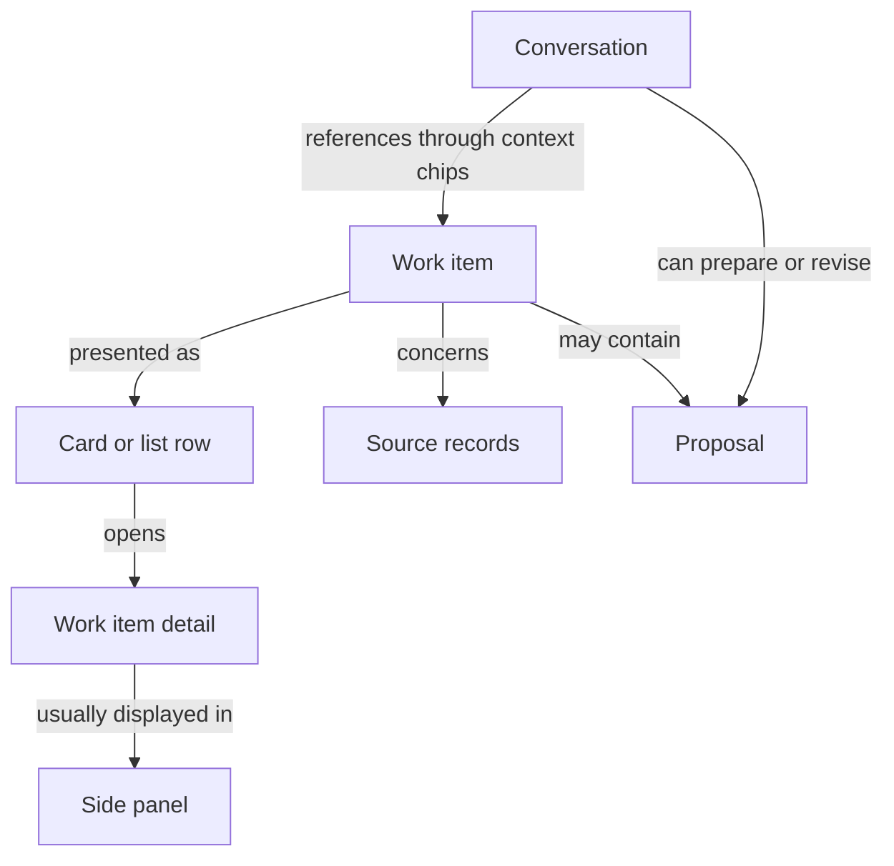
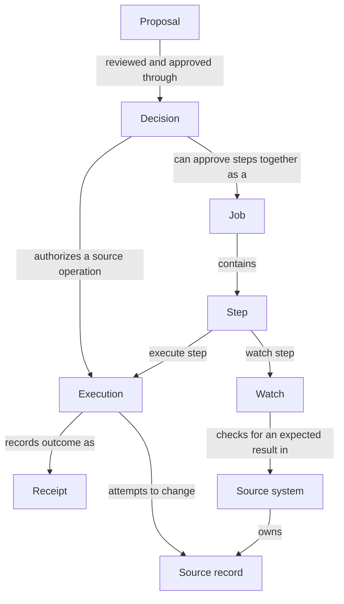

# Clew vocabulary and entity map

A **work item** is something Clew keeps track of for a person. A **card** presents that work item, and a **proposal** describes a suggested change within the work. Opening a card shows the **work item's detail view**, usually in the **side panel**. Opening it does not create a new work item.

Use this vocabulary in product specifications, design discussions and current documentation, as recorded in [D78](../decisions/D78-work-items-cards-and-proposals-have-distinct-meanings.md). The maps describe product relationships, not database tables. Existing code and API names are mapped below; the [implementation status](status.md) remains the authority for delivered features.

## Work and outcomes

| Term | Meaning | Example |
|---|---|---|
| Work item | Something Clew tracks for a person: work to do, a suggestion, work awaiting others, or information to acknowledge. It can concern several source records and remain relevant after an action. | Arrange this month's development meetings. |
| Proposal | A suggested change prepared for review and approval. Qualify it as a booking proposal or job proposal when the distinction matters. Preparing it does not perform the proposed source write. | Proposed meeting times. |
| Source record | A business object owned by a source system. Clew can reference it and retain selected information without taking ownership of the record. | An invoice, absence report or booked meeting. |
| Action | Something the person can do with the work or its records. Actions can read information, prepare proposals, request approved writes or manage work in Clew. | Open details, approve, reschedule or snooze. |
| Decision | The recorded approval of specific work before source dispatch. | Approval to send the selected invitations. |
| Job | A coordinated set of steps approved together, potentially across systems. A job performs a defined part of the person's work. | Register absence, update time reporting and check payroll. |
| Step | One part of a job: an execute step or a watch step. Each names its own connector. | Mark the affected shift as absence. |
| Execution | The durable record of an attempt to perform an approved source operation, including its progress, recovery and outcome. | Sending the absence report to HR. |
| Watch | Bounded checks through a read capability for an expected result. A watch does not perform the source write it observes. | Check whether payroll has imported the absence. |
| Receipt | Evidence of an execution's outcome, including partial, failed or uncertain results and any supported undo. | HR updated; time reporting failed. |
| Conversation | An exchange with the assistant that can refer to work items and other objects. | Why are these invoices overdue? |

A work item need not contain a proposal or require a source write. An informational notice can be a work item; looking up a phone number can be a live read without creating one. A conversation can discuss several work items, and a work item can be referenced from different conversations.

## From a card to the work

The card and list row are presentations of the same work. The detail view is its fuller presentation. The panel is the container that holds it and can also hold other views. On a narrow screen the panel can appear as a drawer; the work item's identity stays the same.

For example, **arrange 20 development meetings** is one work item shown by one card, containing 20 booking proposals. Approval creates bookings in the calendar source. Clew continues tracking the work while replies arrive; the bookings are source records and the conversation about the plan is a separate concept. See the [calendar obligation decision](../decisions/D30-a-proposal-thread-is-an-obligation-with-four-steps.md) for that flow and its limits.

## From a proposal to an outcome

An ordinary source action does not require a job or a separately stored proposal entity. A job groups approved steps; its execute steps use the same execution and receipt machinery. A receipt can report uncertainty, so its existence alone does not establish success.

Within a job, steps are currently independent and prepared from the same fact. The job API, execution ledger and bounded watches exist. The complete job interface and generic continuation from a confirmed receipt to another reviewed proposal remain planned. A work item spanning successive jobs is a product relationship, not a claim that those stage links already exist in storage. See [working across connectors](../architecture/working-across-connectors.md).

## Interface vocabulary

[Interface spaces and navigation](interface-spaces.md) defines placement and return behavior: a page is a destination, a context panel keeps related material beside it, and a focused overlay holds contextual service/review interactions without replacing that destination.

| Term | Meaning |
|---|---|
| Card | A visual presentation of a work item, including its summary and available actions. |
| Row | A compact presentation in a list or table. A work-list row can represent a work item; a row inside a card can represent one of its items. |
| Work item detail | The full presentation opened from a work card or row. It shows the relevant items, proposals, actions, status and outcomes. |
| Page | A navigable destination such as Home, Calendar, a conversation or a tool page. |
| View | A presentation of information. Connector-declared views have the supported forms `table`, `list`, `detail` and `text`. |
| Side panel | The container beside the current page for opened work item details or other views. On narrow screens it can be a drawer. |
| Focused overlay | A temporary interaction above the current page, shown as the existing sidebar Drawer or corresponding mobile sheet. Catalogue drill-in and confirmation retain their parent. |
| Tab | A choice in a tab strip on a page (Hem's lists, the sections of a person's page). The panel beside a page has no tabs: it holds one thing (D110, D66 amended). |
| Context chip | A visible reference attached to a conversation, identifying the work item, record, proposal or other supported object being discussed. |
| Tool | A standing entry point in the product to a capability or view, such as the phone book. Qualify an assistant-callable operation as a **model tool**. |
| Area | A grouping of related capabilities and work available to eligible people. It is not the source record itself. |
| Object | A generic term for something referenceable in the interface, such as a work item, row, event or proposal. Use its specific name when known. |

Opening a source record directly from a table shows that record's detail view. It need not create a work item. Likewise, the word *view* describes a presentation, while *panel* describes where the presentation is held.

## Integration vocabulary

| Term | Meaning |
|---|---|
| Source system | The system that owns business records, source permissions and evidence of source effects. |
| Connector | The integration that maps a source system's API and records to Clew's contract. External connectors are independently deployed HTTP services. |
| Capability | A named operation with input/output schemas, scope and a kind: `read`, `propose` or `execute`. |
| Ref | An identifier resolved through its owning contract for later reads or actions. A ref does not grant access. |
| Scan | A deterministic read that discovers work and returns drafts and occurrence identities. |
| Occurrence | A particular source item and recurring period, scoped to the person, assignment and connector. Its revision identifies material change; one work item can group several occurrences. |
| Fact | A typed business input to job composition, described by a fact kind and attributes. A fact envelope alone does not prove that a source change happened. |
| Follower | A `propose` capability that offers steps for a fact kind. |
| Binding | Administrator configuration allowing a follower to participate for a fact kind and audience. |

A source system owns records. A connector exposes capabilities that read those records, prepare proposals or perform approved operations. Clew renders the results and tracks work, decisions and outcomes. The [connector protocol](connector-protocol.md) defines the wire contract; [working across connectors](../architecture/working-across-connectors.md) explains facts, followers and bindings.

## Identity vocabulary

| Term | Meaning |
|---|---|
| Person | A human in the organisation as Clew holds them: pushed in by the provisioner, able to sign in once a binding exists, deactivated and never erased when they leave. The word in code, tables and audit (`auth_person`, `personId`, `person:<id>`). |
| Provisioner | The installation's own process that reads the organisation's source and pushes people and groups to Clew over SCIM (D68). Not a connector. |
| Group | A group as the source pushed it. A key in its external id (`unit:`, `unit-manager:`, `capability:`, `protected`) gives it meaning; any other group is plain until an administrator maps it to a capability (D85) or names it as an audience. |
| Assignment | One person in one unit with one role, `manager` or `employee`; a person may hold several. |
| Grant | The one assignment a person acts as, with their capabilities: the derived projection every request and connector reads. |
| Binding | The link from an identity provider's subject to a person, written at the first login. (Distinct from a follower binding in the integration vocabulary.) |

## Entity vocabulary

[D97](../decisions/D97-a-source-says-what-its-rows-are-about-and-clew-places-them.md) gives *entity* a narrow meaning, narrower than the "entity map" in this page's title. [Entities](../architecture/entities.md) describes the mechanism.

| Term | In the product | Meaning |
|---|---|---|
| Entity | **person**, **enhet** | A person or a unit Clew holds, which a source's rows can be about. The kinds are the closed list `ENTITY_KINDS`, `person` and `unit`. Not an entity in the domain-driven sense. |
| Key | Not shown | How an entity is named on the wire: a person's provisioned user name, compared without regard to case, or a unit's id. Clew's own person id is never a key. |
| About | Not shown | A capability's declaration of the entity kind its rows concern (`about`). The source says what, never where; Clew places it. |
| Subject | The name as a link | The entity a card row, a search hit or a view record names, by kind and key. Its name then links to the person or unit. |
| Lens | An item under **Visa** | A read about an entity that an administrator offers on the entity's list. Chosen under "Visa", the list becomes that source's view, sorted by need. "Alla" is the list without a lens. |
| Mark | A badge under **Just nu** | A value of a lens with a `warn` or `alert` tone, shown on the entity's row on "Alla". "Just nu" also counts the reader's cards about the person ("1 att agera på", "2 förslag"). |
| Section | **Behöver dig**, then each source's title | One source's part of the opened person or unit, named with its source ("Clew" for Clew's own domain). "Behöver dig" is the section of the reader's own cards that name the entity. |
| Column on "Alla" | A column heading with the source under it | One field of a read about an entity, chosen by an administrator under "Kolumn på Alla" and shown to everyone who has the list. At most three per entity kind. |
| Opened entity | The page's heading, the person's or the unit's name; on the person's page the tab strip **Om <namn>** | A person or a unit as a page ([D110](../decisions/D110-where-something-opens-is-decided-by-what-it-is.md) rule 3). |

## Naming rules

- Say **person** in code, tables and documentation, **användare** in the Swedish interface (the administrator's word; the page is Användare, D62), and **User** only for the SCIM resource at `/scim/v2`. The person is the human; the account is the binding; the User is the standard's name for the person as pushed.

- Use **work item** for the tracked work in specifications and documentation. Use **card**, **row** and **panel** for presentation and layout.
- Name the concrete content in the Swedish interface: **Granska fakturor**, **Visa bokningsförslaget**, **Öppna sjukanmälan**. The internal umbrella term does not require a generic label on every screen.
- Use **proposal** for suggested changes awaiting review; qualify booking and job proposals when necessary. Work can remain open after its proposals have been approved.
- Use **conversation** for the exchange with the assistant. Keep **thread** for references to existing implementation names.
- Reserve **case / ärende** for actual cases from source systems. It is not the generic name for all work in Clew.
- Say **card item** or **source record** when plain *item* would be ambiguous. A card item can represent a record or explanatory content; not every displayed row is a separate work item.

For a design discussion: **Open the work item from its card and review the proposal in the side panel.**

## Mapping to the current code

These names clarify product language without renaming types, API routes or stored records.

| Product concept | Current implementation |
|---|---|
| Work item and conversation | Both use [`Thread`](../../packages/contracts/src/index.ts), whose `kind` is `pushed` or `question`. `Thread` includes work fields and messages; it is not an exact synonym for either product concept. |
| Booking proposal | [`Proposal`](../../packages/contracts/src/index.ts) is calendar-specific and belongs to a thread. It is not the generic type for every proposal in Clew. |
| Job proposal | [`JobProposal`](../../apps/server/src/modules/jobs/contracts.ts) contains a fact, proposed steps and participating-source status. Immutable server-side storage of reviewed job proposals remains planned. |
| Card item and action | [`ThreadItem` and `ThreadAction`](../../packages/contracts/src/index.ts) describe a card's content and available actions. |
| Decision, job, step, execution and watch | The [execution model](../../apps/server/src/modules/executions/model.ts) records `decisionId`, `Job`, `JobStep`, `Execution` and watch state. A product term does not imply a separate table of the same name. |
| Receipt | [`Receipt`](../../packages/contracts/src/index.ts) is the displayed outcome; connector execution results provide the underlying evidence. |
| Context chip and object | [`Chip` and `ClewObject`](../../packages/contracts/src/index.ts) provide references for conversation context and object selection. |
| Side panel | [`PanelFrame`](../../apps/web/src/components/panel.tsx) holds the one thing opened. Their existing `card` and `view` names remain implementation identifiers. |
| Entity, subject, lens, section and column | [`EntityKind`, `Subject`, `About`, `EntityList`, `EntityDetail`, `EntitySource` and `EntityColumn`](../../packages/contracts/src/index.ts); the use cases in [`modules/entities`](../../apps/server/src/modules/entities/); the index from entity to cards is the table `thread_subject` in [the schema](../../packages/db/src/schema.ts). A capability's lens and column are `lens` and `column` in its stored overrides. |
| Person, group, assignment and grant | [`auth_person`, `auth_group`, `auth_assignment` and `auth_access_grant`](../../packages/db/src/schema.ts); the SCIM resources `User` and `Group` are drawn from them in [`modules/people/domain.ts`](../../apps/server/src/modules/people/domain.ts). A group's name is `label` in Clew and `displayName` on the wire. |

Earlier decisions and reviews retain their historical wording. Read their uses of *card* or *thread* in context, and use this vocabulary when writing new product explanations.
