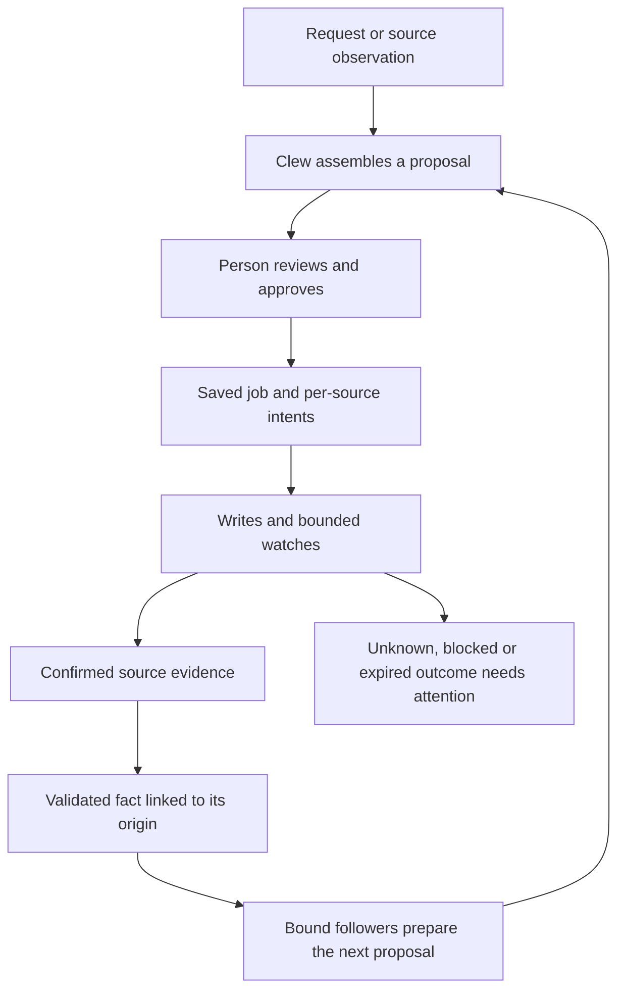

# Exploration: carrying one task across connectors and approvals

Date: 2026-11-07. Reviewed revision: `8bae24e`.
Status: exploration and implementation recommendation at the reviewed revision. The [outcome below](#outcome-approval-and-receipt-fixes) records subsequent fixes under D77; the broader continuation design remains a recommendation.

## Recommendation

Keep one visible task for the person, with a sequence of reviewed proposals underneath it. Clew assembles each proposal from connector offers, records one approval for that stage, tracks each source's result, and uses confirmed evidence to prepare a later proposal when needed. PostgreSQL owns the decisions and evidence; the existing outbox and Temporal deliver the work and waits.

This develops [D55](../decisions/D55-a-job-is-assembled-from-what-connectors-follow-approved-once-and-run-per-system.md), whose initial job machinery exists. Build a usable, recoverable journey through it, followed by one evidence-backed continuation. A new workflow engine is not needed for that scope.

First address the three reproduced approval/read gaps below. Then define the missing proposal and fact records: `creates` metadata alone does not provide continuation.

## Which work belongs together?

| Situation | How Clew should handle it | Example |
|---|---|---|
| Several changes can be prepared from the same request or observation | Assemble one job, show all proposed changes, approve once and track each independently. | Register an absence in HR and mark the shift in time reporting. |
| Another action needs an identifier or result that does not exist yet | Wait for confirmed evidence, prepare the next proposal and obtain a new approval within the same task. | Create a case, then propose a calendar event linked to its confirmed identifier. |
| A source already propagates the change to another system | Watch that system within an approved window. | Payroll imports HR records; Clew checks whether the absence appeared. |
| Someone must act in a system without a write API | Provide a link and instructions; watch if the result can be read. Otherwise distinguish manual confirmation from source evidence. | Complete a source-owned form, then check its status. |
| Another person or an organisational process owns the next decision | Follow the owning system's status and link to its approval. | Finance requires a separate approver; Clew cannot borrow the first person's authority. |

The first case has API/ledger support and fixture evidence. Generic result-driven continuation, complete job presentation, and a general manual-step or multi-person task contract are not delivered features.

For connector authors: if the next write needs the preceding write's output, it cannot be an independent step of the same job. Declaring the two steps in order does not establish that dependency.

## A complete absence journey

1. The person enters an absence, or Clew discovers an existing report. Distinguish a requested change from an observed source fact: a draft request is not proof that HR has changed.
2. Bound followers prepare the HR write, time-reporting write and payroll watch. If HR already has the report, its follower offers no duplicate write. Clew names unavailable participants.
3. The person reviews the changes and approves that exact revision. Each connector executes its own part; payroll is watched through its existing import.
4. Clew shows each outcome. A lost HR response stays unresolved until supported source recovery establishes what happened. A successful time-reporting step stays successful.
5. A confirmed time-reporting result may establish an unstaffed shift, prompting a proposal to arrange cover. A calendar connector can propose moving an affected meeting when it has enough authorised information. These are examples of intended continuation, not existing fixture capabilities.
6. The person approves the next proposal. The task retains earlier receipts and the reason for the new work. Declining that proposal does not undo the absence.

The proposed lifecycle is:

Only confirmed evidence enters continuation. A fact about one confirmed item need not wait for an unrelated step. A condition involving several results must be established by an authorised source read or a defined proposal capability; one receipt cannot establish all-systems success.

## What exists, and what is missing

| Area | Evidence in this revision | Consequence |
|---|---|---|
| Assembly | [Jobs use cases](../../apps/server/src/modules/jobs/usecases.ts) ask bound followers and report partial results. [The protocol](../../packages/connectors/src/protocol.ts) defines fact envelopes and execute/watch drafts. | Reuse this assembler; preparing a proposal performs no source writes. |
| Execution | [Execution use cases](../../apps/server/src/modules/executions/usecases.ts) authorise each step and commit the job, executions, audit and delivery intents together. | Reuse the ledger and per-source recovery. Source systems do not share a transaction. |
| Waits | Watch intents feed [Temporal workflows](../../apps/server/src/dbos/workflows.ts); observations settle seen, blocked or expired. | Preserve bounded windows. Watch cancellation and evidence-bearing continuation need a contract. |
| Reviewed proposal | [The approval route](../../apps/server/src/routes/api.ts) accepts the proposal from the client. Approval rereads binding window caps but does not resolve an immutable server-side proposal or recheck binding eligibility. | Add proposal identity/revision and verify current governance. Existing per-capability authorisation remains necessary. |
| Fact validation | The generic `FactEnvelope` accepts an attributes record. Fact schemas compile at registration, but the assembler does not validate the fact against its creator's schema or establish source evidence. Individual capabilities can impose additional input checks. | Validate facts at entry, resolve refs under current access, and distinguish requests from observations. |
| Continuation | [ExecuteResult](../../packages/connectors/src/index.ts) has receipt/undo fields, without a standard emitted-fact envelope. [Jobs](../../apps/server/src/modules/executions/model.ts) store steps and authority, without the originating fact, reviewed proposal or parent-stage link. Watch observations retain a match result, not a reusable source fact. | Design typed evidence-to-fact delivery and causal links. Do not extract business facts from receipt wording or HTTP success alone. |
| Presentation | Job routes and watch-expiry cards exist; complete job cards, binding screens and automatic entry paths do not. | Show one task with its reviewed stages, individual outcomes and next action. The model remains optional. |

## Three reproduced gaps to fix first

These are in-memory use-case reproductions using the existing signed HR, time-reporting and payroll fixtures. They do not mutate a live source or demonstrate an HTTP-level permission bypass.

1. **Approval replay changes watch times.** Assemble and approve a job with the payroll watch; advance the injected clock one second; submit the same proposal and decision id. `jobs.approve` derives new absolute check times, so the ledger rejects the replay with “Beslutet gäller redan ett annat innehåll.” Preserve the first committed schedule and compare the same reviewed intent on replay. A retry after a lost approval response must return the existing job.
2. **A disabled binding does not invalidate an old proposal.** Assemble the absence job, disable `timesheet.followAbsence` through the binding use case, and assemble again: the new proposal omits it. Approving the old proposal still creates that execution. Recheck binding identity, enabled state, audience and compatibility at approval. This is a governance gap, not evidence that the source's execution permission is bypassed.
3. **Job reads do not fence receipts by producing authority.** Approve and settle the fixture job, then call `readJob` for the same person with a different unit and authorisation version. It returns the confirmed HR receipt. The method checks person ownership and calls `persona.authorize()`, but neither compares stored authority nor reauthorises sources before returning receipts. Apply [D75's producing-authority policy](../decisions/D75-source-snapshots-retain-the-authority-that-produced-them.md) and current source visibility to the job projection and future proposals/facts. A new grant must not make old snapshots readable again.

Add regression cases at these boundaries before building on them. The original tests did not cover these findings. They were subsequently fixed and covered by regressions; see [Outcome](#outcome-approval-and-receipt-fixes).

## Minimum additional state

Use the existing thread or card as the person's task, linking stages beneath it. Keep execution/watch state in its current ledger. These are proposed responsibilities, not wire fields available to connector developers today:

| Record | Required information | Purpose |
|---|---|---|
| Reviewed proposal | Actor and producing authority, originating request/fact, binding and contract revisions, immutable steps and display content, missing participants, expiry and revision. | Approve what was reviewed. Editing input or discovering another participant produces a new revision. |
| Confirmed fact | Owning connector, kind, validated minimal attributes, source object/occurrence and revision, observation time, producing authority, and the receipt item or authorised read establishing it. | Explain the next action; a draft, unknown write or unrelated receipt cannot start it. |
| Continuation intent | Originating evidence, task/stage link, recipient, deduplication identity and pending/prepared/blocked/dismissed outcome. | Recover after crashes without losing or duplicating proposals. |
| Stage linkage | Parent proposal/job and the fact leading to the next proposal. | Preserve one history without duplicating execution state or defining an organisational process. |

Commit a continuation intent with the evidence that makes it eligible, then deliver it through the existing outbox/worker pattern. The worker rechecks access and bindings and asks followers for proposals; it cannot approve the next job. Stop at that proposed stage: do not recursively fan out facts from unapproved drafts. This requires an explicit contract and implementation change; settlement does not do it today.

Deduplicate by source occurrence/revision and causal evidence for the intended recipient, not arrival time or receipt text. Preserve stable step identities and originating bindings. Today's connector-plus-array-position step ids are insufficient for several followers from one connector or durable proposal revisions.

Facts obey the same storage/access rules as other source-derived snapshots. Prefer refs and the attributes needed for the next proposal; canonical records stay in their source systems.

## Decisions at the boundaries

**Partial proposals.** Name missing participants. For the first slice, require those needed by the scenario before approval. If a later product permits proceeding with a subset, make the omitted work explicit in a new reviewed revision. A recovered connector must never silently add writes to an existing approval.

**Uncertain writes and corrections.** Recover the existing operation through its declared strategy. Do not create a fresh operation merely to clear an unknown state. Changed source revisions require fresh evidence and review of dependent proposals. Reconciliation may establish a fact once; replay must not prepare it again.

**Undo and stopping.** Undo is a new approved compensation per source, with separate outcomes; it cannot promise atomic rollback or erase receipts. Undoing an earlier stage should invalidate unapproved dependent proposals. Already approved later work needs explicit review and compensation where supported. Stopping follow-up is distinct from undoing writes; watch cancellation needs a persisted generation/state fence.

**Connector replacement.** `hr:absence` currently belongs to the `hr` connector. The [earlier fact-kind review](2026-11-06-fact-kinds-ownership-and-dependency-visibility.md) recommends a small Clew-owned vocabulary; that is not the implemented protocol. Prove one shared business fact with two real adapters before broadening the catalogue. Keep translation in adapters, not administrator-authored mappings. Establish trusted cross-source person identity: the fixture HR employee ref is not a universal contract.

**One approval for dependent writes.** D55 requires a new approval for each dependent stage. If real users need one approval over a whole dependent sequence, treat that as a separate product decision. It needs a reviewable bounded plan, exact permitted data substitutions, authorisation at every step, and explicit failure/compensation rules. Do not introduce that behaviour implicitly through `creates` or model reasoning.

**Another person's decision.** Keep source-owned approval processes authoritative. A second Clew approver requires assignment, delegation and visibility rules; the first person's approval does not authorise another person's actions.

## Deliver in three increments

1. **A trustworthy first job.** Close the three reproduced gaps, persist the reviewed proposal, and expose the existing absence journey through a Clew-drawn review/progress view. Include binding administration and missing-source handling for that scenario. Acceptance: two writes and one watch; identical approval replay across time/restart; changed bindings requiring review; revoked snapshots hidden; individual outcomes visible. Verify keyboard access, screen-reader announcements and phone reflow.
2. **One result leading to one later proposal.** Add the smallest typed fact/continuation contract and prove an unstaffed-shift follow-up with an adapter or fixture supplying that evidence. Acceptance: receipt commit followed by worker failure still yields one later proposal; unknown/failed items yield none; repeated evidence yields no duplicate; edits/undo invalidate stale unapproved work; the next job needs another human approval. Prove the database/outbox/Temporal boundary as well as fixtures.
3. **A real-source pilot and dependency visibility.** Run the journey against available test systems, establish identity mapping and background authority, and show what depends on each connector. Extend shared kinds only when evidence requires it. Acceptance: differing source permissions, outages, changed contracts, authentic source recovery and usable per-stage receipts.

The first increment precedes generic continuation. External event ingest, arbitrary process graphs and speculative fact catalogues are not prerequisites.

## Verification and limits

- Read the assembler, approval routes, execution/watch use cases and models, schemas, registry validation, fixtures, D55/D75 and earlier composition reviews.
- Ran `bun test tests/unit/job-executions.test.ts tests/unit/fixture-job.test.ts`: **27 passed, 171 assertions**.
- Three isolated experiments derived from the fixture setup, with an injected clock and in-memory stores, reproduced the findings above. No development or production database was mutated.
- Documentation generation/checks, local links and the signed connector smoke passed. All five repository Mermaid diagrams passed syntax validation; required formatting and whitespace checks passed.
- This review does not implement continuation, repair the findings, validate a real vendor integration or settle a new architecture policy.

## Outcome: approval and receipt fixes

Implemented on 2026-11-07 under [D77](../decisions/D77-job-approvals-preserve-intent-bindings-and-receipt-authority.md), following the product owner's request to fix the findings.

- Job approvals compare relative watch intent while preserving the first committed absolute schedule. Later and concurrent retries keep one job, execution set, approval audit and watch intent; changed effective intent is refused.
- Assembly includes binding identity and revision. Approval refreshes governance, checks the current binding set, eligibility and step association, and repeats the check after step authorisation before commit. Two followers from one connector have separate step identities and binding-specific watch limits.
- Job and individual execution receipt paths require the original person, unit and authorisation version. Job reads check current execute/watch capability access before exposing any part of the composite, and recheck person authority after those checks. Approval replay, reconciliation, compensation and calendar approval lookup retain the same producing-authority boundary. Stored evidence is preserved.
- A PostgreSQL regression recreates the stores and use cases after approval, advances time, and proves replay preserves the original schedule and existing receipt without another execution, job approval or watch intent. It also exercises changed authority, changed input and a disabled binding.

These fixes close the three reproduced gaps. The first delivery increment remains incomplete: immutable server-side reviewed proposals, full job/binding screens, fact provenance and creator-schema validation still need implementation. Binding revision metadata is not a signature of the proposal. Receipt-driven continuation and the broader staged task design remain planned.

Fix verification: standard checks passed (567 unit/web tests, 6 Node runtime tests, formatting/types/dependencies/purity/docs); PostgreSQL suite 54 passed; durable-workflow suite 3 passed against PostgreSQL, Temporal and Node; whitespace check clean. No live vendor integration or UI change was tested in this backend fix.
