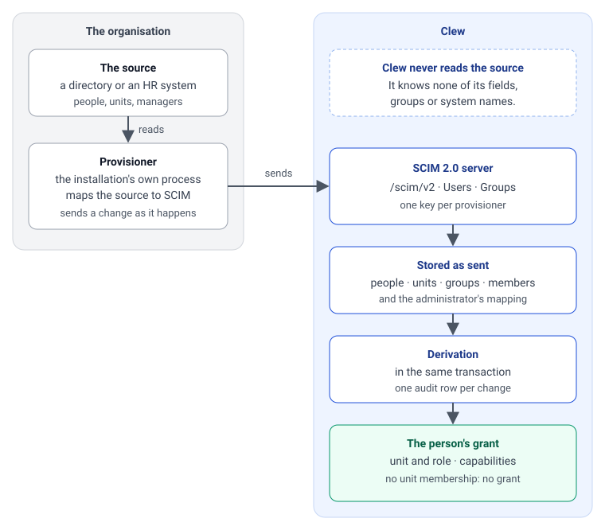

# Inläsning av personer och organisation: vad driften levererar

[Den här sidan på engelska](../../guides/provisioning-for-operations.md)

Den här sidan är till för dem som driver en installation av Clew: teamet som har hand om organisationens katalog, teamet som har hand om inloggningstjänsten (identity provider, IdP) och teamet som driftar Clew. Den säger vad var och en levererar innan någon kan logga in, vad som måste besvaras innan något byggs och hur man ser att det fungerar. Själva protokollet, varje attribut och varje svar, står på engelska i [Writing a provisioner](../../guides/writing-a-provisioner.md).

Clew läser aldrig organisationens katalog. Personer, enheter och grupper skickas in i Clew av en **provisionerare**, ett program som installationen kör själv, över standarden SCIM 2.0. På sidan Administration › Användare kallas provisioneraren "katalog" och dess token "nyckel". Den som inte har skickats in kan inte logga in, och den som har skickats in loggar in genom organisationens egen inloggningstjänst.



Serversidan är byggd och testad med en syntetisk katalog på tvåhundrafemtio personer. Ingen provisionerare har ännu körts mot en verklig källa, och ingen annan inloggningstjänst än utvecklingsmiljöns har loggat in någon ([implementation status](../../reference/status/identity.md)). Den första installation som gör båda kommer att hitta sådant som den här sidan inte säger; berätta för Clew-teamet vad det var.

## Vem levererar vad

| Team | Levererar | Avsnitt |
|---|---|---|
| Katalogteamet | En provisionerare: ett program som skickar varje ändring i källan till Clew när den sker, och jämför hela källan med Clew minst en gång per dygn | [Katalogteamet](#katalogteamet-en-provisionerare) |
| IdP-teamet | En klient för Clew, det claim som bär kontonamnet, och konton som stängs när en person slutar | [Inloggning](#inloggning-idp-teamet) |
| Driften av Clew | En publik adress över HTTPS, en proxy som släpper igenom en inläsning, en plats för nyckeln, den första nyckeln och en testinstallation | [Drift](#drift-adress-nyckel-och-testinstallation) |
| Clews administratör | Provisionerarens nyckel, som byts eller återkallas på Administration › Användare | [Vad Clew ger tillbaka](#vad-clew-ger-tillbaka) |

## Svara på det här innan något byggs

Formatet passar en källa som kan svara ja på de tre första frågorna. Varje svar ändrar hur provisioneraren skrivs, så de kommer först.

| Fråga | Varför Clew behöver svaret |
|---|---|
| Har varje person ett id som är stabilt och aldrig ges till någon annan? | Clew hittar personen på det vid varje senare inläsning (`externalId`). Ett id som ändras ger en ny person; ett id som återanvänds ger en persons historik till en annan. |
| Kan enheterna levereras som en egen lista, var och en med id, namn och id på enheten ovanför? | Clew håller organisationen som ett träd och räknar aldrig ut det ur personerna. Ett träd som bara finns som en sökväg på varje person måste göras om till enheter i provisioneraren. |
| Överlever enheternas id en omorganisation? | Allt i Clew som pekar på en enhet följer id:t. En enhet som flyttas behåller sitt id och byter bara enheten ovanför; en enhet som får ett nytt id är en ny enhet för Clew. |
| Vad avser källans chefsflagga, och var är en chef placerad: på enheten hen leder eller på den ovanför? | En chef måste skickas som chef för den enhet hen leder. Vem en person rapporterar till läses ur det och ur trädet. |
| Har en person någonsin en andra placering, eller är chef under en period? | Båda är medlemskap som provisioneraren lägger till och tar bort. Clew håller inga datum, så perioden finns i källan. |
| Kan källan tala om för provisioneraren att något har ändrats (en händelse, en ändringslogg, en fråga om vad som har ändrats sedan en tidpunkt)? | En ändring skickas till Clew när den sker. En källa som bara kan läsas i sin helhet ger en provisionerare som måste jämföra ofta för att komma nära. |
| Ges ett kontonamn någonsin till en ny person? | Den som slutar avaktiveras, raderas inte, och behåller kontonamnet. Provisioneraren måste först flytta det från den gamla raden. |
| Vilket claim i inloggningstjänstens ID-token bär kontonamnet? | En första inloggning matchas på det, mot det `userName` som provisioneraren skickade. De två måste vara samma värde för samma person. |

## Katalogteamet: en provisionerare

En provisionerare är ett litet program: exemplet i kodförrådet, [scripts/provisioner/](../../../scripts/provisioner), är ungefär tvåhundra rader med en SCIM-klient på fyrtio rader. Byt ut dess läsare mot en som läser er källa och behåll resten, eller skriv en egen i vilket språk som helst. Den är den enda plats som känner till källans fält, grupper och roller.

Den gör två saker ([D109](../../decisions/D109-a-provisioner-sends-a-change-when-it-happens-and-reconciles-the-whole-source-daily.md)). Den skickar varje ändring till Clew när den sker, och det är regeln. Och den jämför hela källan med det Clew håller minst en gång per dygn, och det är nätet under regeln: en ändring som tappades på vägen hittas inte av något annat. Exemplet gör bara det andra, eftersom dess källa är en fil utan händelser; att skicka en ändring när den sker är ert att lägga till.

### Vad den läser ur källan

| Ur källan | Blir i Clew | Krävs |
|---|---|---|
| Varje enhet: id, namn, id på enheten ovanför | En grupp `unit:<id>` med namnet och dess `parent`. En enhet som ingen är placerad på, till exempel en rubrik över flera avdelningar, skickas också. | Ja |
| Varje person: stabilt id, kontonamn, namn, jobbadress, om personen är aktiv | En användare med `externalId`, `userName`, `displayName`, `emails` och `active` | Ja, alla fem |
| Var varje person arbetar | Medlemskap i gruppen `unit:<id>` för den enheten | Ja: en person utan enhet finns men kan ingenting göra |
| Vem som leder varje enhet | Medlemskap i gruppen `unit-manager:<id>` för den enheten. En gång, på enheten hen leder; inte på varje enhet under den. | Ja, för alla som ska se sina medarbetare |
| Vem som administrerar Clew | En grupp vars medlemmar får en behörighet: `capability:admin.users`, `capability:admin.connectors` eller `capability:admin.appearance`, eller vilken kataloggrupp som helst, som en administratör sedan kopplar till en behörighet i Clew | Minst en person med `admin.users`, annars kan ingen administrera installationen |
| Övriga kataloggrupper | Vanliga grupper. De betyder ingenting förrän en administratör kopplar en av dem till en behörighet eller använder den som målgrupp för ett anslutet system. | Nej |

Skicka inte uppgiften om att en person har skyddade personuppgifter. Clew har inte avgjort om det får hålla den uppgiften, och nekar nyckeln `protected`.

### Vad den skickar när något ändras

Ett anrop för varje ändring, eller två för en flytt, skickat när ändringen sker i källan och inte sparat till natten. Personen har rätt åtkomst vid sitt nästa anrop. Anropet för varje slags ändring står i [Writing a provisioner](../../guides/writing-a-provisioner.md#what-a-provisioner-does-when-something-changes).

- **En person börjar, slutar eller byter namn, kontonamn eller adress:** ett anrop på personen.
- **En person flyttar, blir chef eller slutar vara det, får eller förlorar en behörighet:** ett anrop på gruppen, inte på personen. En flytt lägger till personen på enheten hen kommer till innan den tar bort hen från enheten hen lämnar.
- **En enhet läggs till, byter namn, flyttas eller tas bort:** ett anrop på enhetens grupp. En flytt behåller enhetens id och byter bara enheten ovanför.
- **En ändring som börjar gälla en viss dag,** till exempel en tillförordnad chef från den första i månaden, skickas den dagen. Clew håller inga datum.

### Vad den dagliga jämförelsen gör

Ordningen spelar roll; skälen står i [Writing a provisioner](../../guides/writing-a-provisioner.md#what-a-provisioner-does-on-every-reconciliation).

1. **Stanna vid en tom källa.** Jämför personerna i källan med dem som Clew håller. När källan inte listar någon, eller långt färre än Clew håller, stanna och låt en människa avgöra. Clew kan inte skilja en tom export från en verklig ändring, och skulle avaktivera alla. Exemplet vägrar en jämförelse som skulle avaktivera fler än en femtedel.
2. **Organisationen först,** från roten och nedåt, varje enhet med sitt namn och enheten ovanför.
3. **Sedan personerna:** nya skapas, ändrade skrivs och de som inte längre finns i källan avaktiveras.
4. **Sedan vem som är var, i två varv:** först får varje grupp de medlemmar den får, sedan förlorar varje grupp de medlemmar den förlorar. En person som flyttar mellan två enheter är då i båda ett ögonblick och aldrig i ingen. Åt andra hållet förlorar personen sin åtkomst mellan de två skrivningarna och loggas ut mitt i arbetet.
5. **Sist de enheter och grupper som är borta,** från löven och uppåt.

En jämförelse en dag då varje ändring kom fram skriver ingenting, och en som dör på vägen rättas till av nästa.

### Att köra den

- **Ändringar när de sker, jämförelsen minst dagligen.** Clew håller inga giltighetsdatum: åtkomst börjar och slutar när ändringen kommer, och till dess gäller den åtkomst personen hade.
- **Skicka ett misslyckat anrop igen.** En ändring som inte skickas igen väntar på jämförelsen, som kan vara ett dygn bort.
- **Larma på en ändring som inte gick att skicka, och på en jämförelse som misslyckades eller aldrig startade.** Clew visar när varje provisionerare senast hörde av sig, med en varning efter två dagars tystnad, på Administration › Användare. Clew larmar inte själv och exporterar inget mätvärde för det, så larmet är provisionerarens eget.
- **Förvara nyckeln i ett hemlighetsförvar.** Nyckeln är en bearer-token för det här ändamålet och inget annat. Den visas en gång när den utfärdas och slutar aldrig gälla av sig själv.
- **En organisation per installation** är det som stöds i dag.

### Klart när

- [Kontrollen](../../guides/writing-a-provisioner.md#checking-a-push) räknar lika många rötter som källan har och pekar inte ut något ni inte kan förklara: ingen aktiv person utan enhet, ingen enhet med chef men utan enhetsgrupp, och ingen enhet vars personer inte rapporterar till någon om inte källan säger det.
- Administration › Organisation visar trädet som källan har det.
- En jämförelse direkt efter en annan skriver ingenting.
- En person som flyttas i källan är flyttad i Clew utan att vänta på jämförelsen, och var aldrig utan enhet däremellan.

## Inloggning: IdP-teamet

Clew loggar in personer med OpenID Connect och skapar ingen vid inloggning. Inloggningstjänsten går i god för kontot; provisioneraren har redan sagt vem personen är.

| Vad | Värde |
|---|---|
| Klient | Konfidentiell (med klienthemlighet), Authorization Code med PKCE (`S256`) |
| Scope | `openid profile email` |
| Adress för omdirigering | `<Clews publika adress>/api/auth/callback` |
| Adress efter utloggning | `<Clews publika adress>/login` |
| Back-channel logout | `<Clews publika adress>/api/auth/backchannel-logout` (OpenID Connect Back-Channel Logout) |
| Utfärdare (issuer) | Över HTTPS, med sitt discovery-dokument nåbart från Clews server |

- **Claimet.** ID-token bär kontonamnet i ett claim, `preferred_username` om installationen inte säger något annat. Provisioneraren skickar samma värde som `userName`. Clew jämför dem utan hänsyn till stora och små bokstäver, och matchar aldrig på en e-postadress eller ett namn. En första inloggning binder kontot till den enda person som har det `userName`; ingen träff, eller två, är en nekad inloggning.
- **Lämna till driften av Clew:** utfärdarens adress, klient-id, klienthemligheten och claimets namn när det inte är `preferred_username`.
- **Stäng kontot när en person slutar.** Avaktiveringen i Clew kommer när provisioneraren skickar den; inloggningstjänsten är det som stoppar en inloggning om den ändringen dröjer.
- **Ett konto som ersätts binds inte om.** När en person får ett nytt konto i inloggningstjänsten under samma kontonamn nekar Clew inloggningen tills en människa har tittat på det.

### Klart när

- En person som har skickats in loggar in, och Administration › Användare visar att hen har gjort det.
- En person som har ett konto i inloggningstjänsten men inte har skickats in nekas.
- En utloggning i inloggningstjänsten avslutar sessionen i Clew.

## Drift: adress, nyckel och testinstallation

| Vad | Värde |
|---|---|
| Publik adress | `PUBLIC_URL`, över HTTPS, utan sökväg. SCIM-servern svarar på `<publik adress>/scim/v2`. |
| Nåbar från | Den plats där provisioneraren körs. Ingen annan behöver `/scim/v2`; den kan stängas för alla andra nät. |
| Storlek på ett anrop | Släpp igenom 4 MB. Clew nekar själv en större kropp. Det största anropet är en enhetsgrupp med alla sina medlemmar. |
| Tid för ett anrop | Den första skrivningen av en grupp med tiotusen medlemmar tog ungefär fem sekunder i utvecklingsmiljön. Bryt inte ett anrop innan dess, med marginal. |
| Medan Clew startar | Den svarar 503 med `Retry-After`. En provisionerare väntar och försöker igen. |
| Inställningar för inloggning | `OIDC_ISSUER`, `OIDC_CLIENT_ID`, `OIDC_CLIENT_SECRET` och, när claimet inte är `preferred_username`, `OIDC_BINDING_CLAIM`, från IdP-teamet |

- **Den första nyckeln kommer från ett skript.** Ingen är administratör förrän en provisionerare har skickat den grupp som gör någon till det, så den första nyckeln i en installation utfärdas inne i app-containern:

  ```bash
  bun scripts/provisioner-token.ts add <id> --organisation <organisation> --label "<namn>"
  ```

  Nyckeln skrivs ut en gång; Clew behåller bara dess kontrollsumma. Lämna den till katalogteamet genom hemlighetsförvaret, inte i ett meddelande.
- **Därefter på sidan.** En administratör med `admin.users` lägger till en provisionerare, byter dess nyckel och återkallar den på Administration › Användare. En nyckel som byts kan fortsätta att gälla i ett dygn eller en vecka, så att provisioneraren ställs om utan att en inläsning misslyckas.
- **En testinstallation först.** Ge katalogteamet en installation att skicka till före den riktiga, och en nyckel under ett eget id för kontrollen, så att en kontroll inte räknas som ett anrop från provisioneraren.
- **Vad som ska bevakas.** Ett oväntat fel i en inläsning är en rad på nivån `error` med scope `scim` i serverloggen. Vad en inläsning ändrade står i granskningsloggen ([operations runbook](../../maintainers/reliability-operations.md#provisioning)).

## Vad Clew ger tillbaka

- [Writing a provisioner](../../guides/writing-a-provisioner.md): attributen, gruppnycklarna, organisationsträdet, transporten och varje nekande svar.
- [scripts/provisioner/](../../../scripts/provisioner): ett exempel att utgå från, med sina tester.
- [scripts/provisioner-check.ts](../../../scripts/provisioner-check.ts): läser vad en inläsning lämnade efter sig, enbart över SCIM, och ändrar ingenting.
- Administration › Användare: provisionerarna och när var och en senast hörde av sig, personerna med enhet, roll och behörigheter, och om var och en har loggat in.
- Administration › Organisation: trädet som det skickades in, och vad en inläsning lämnade fel.

## Inte avgjort ännu

Fyra saker är öppna på Clews sida och ändrar vad som skickas. De står bland de [öppna frågorna](../../maintainers/open-questions.md).

- Om personer som inte ska kunna logga in ska skickas in alls. I dag får alla som skickas in ett konto.
- Om Clew får hålla uppgiften om att en person har skyddade personuppgifter. Tills det är besvarat: skicka den inte.
- Om en person med flera placeringar kan växla mellan dem. I dag agerar de som en: en enhet de leder före en enhet de arbetar på.
- Om en installation kan hålla flera organisationer. I dag är det en.
